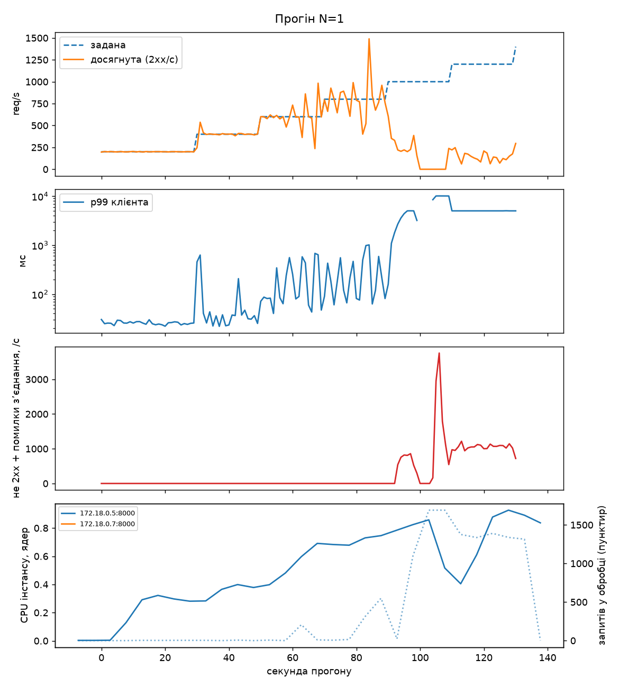
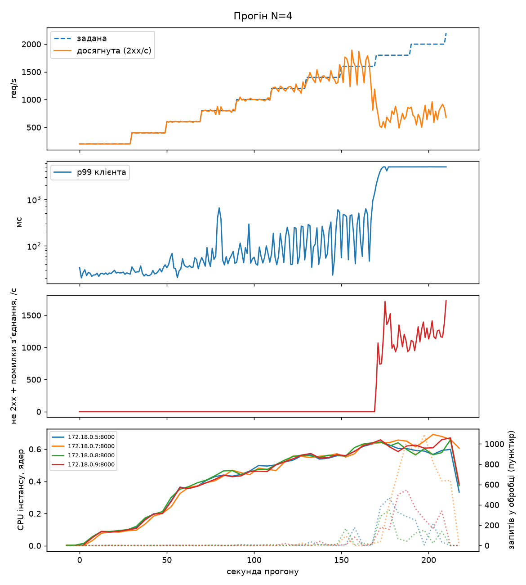
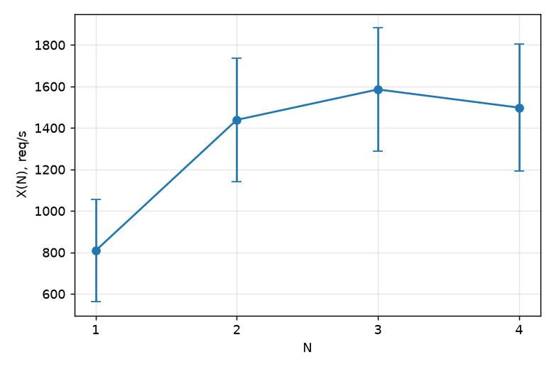
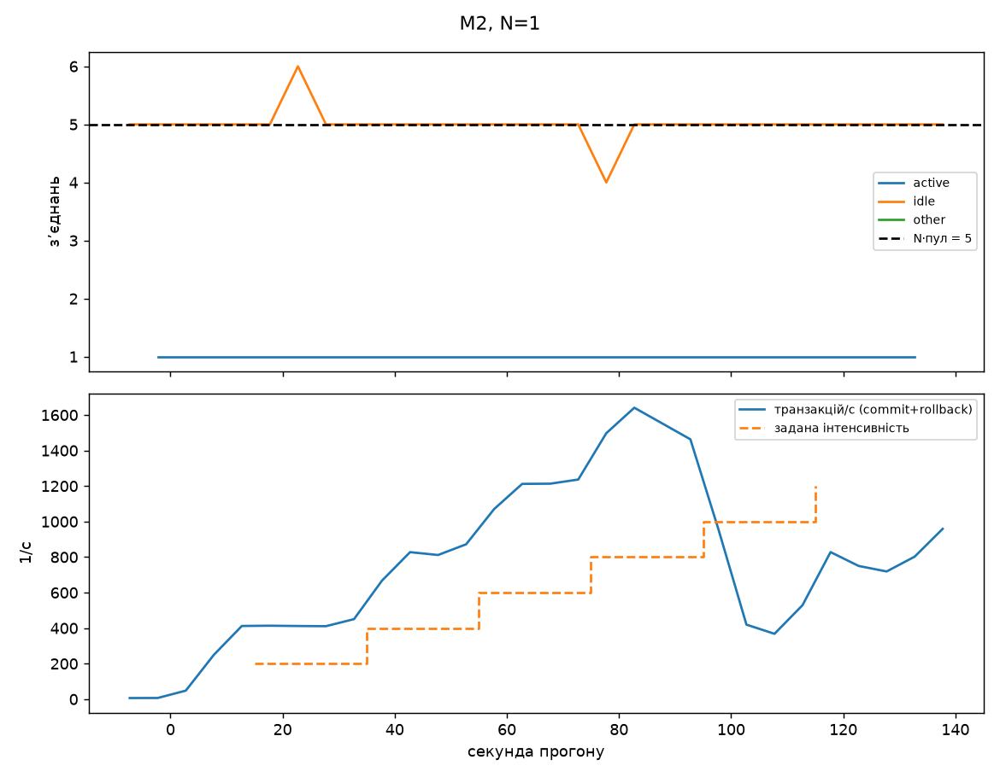
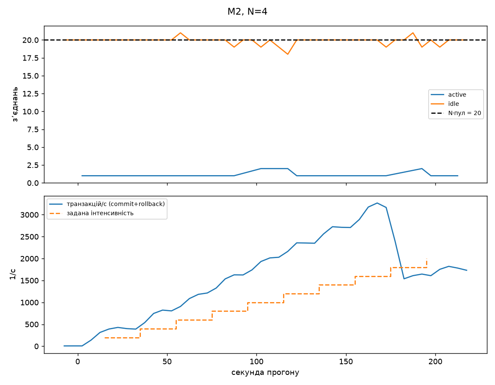

# Звіт. Лабораторна робота 2: метрики сервісу і межа масштабованості (варіант 12)

Продовження лабораторної 1 (`/admissions`, FastAPI + PostgreSQL + nginx). Параметри варіанта:
розмір пулу зʼєднань **5**, набір бакетів **Г3**, додаткова метрика **М2** (postgres-exporter).
Ліміти контейнера web із лабораторної 1 не змінювались: 1 CPU, 512 МБ (ліміт не зменшувався: усі точки X(N) вийшли необмеженими генератором, див. розділ 6).

Умови вимірювань: Windows, Docker Desktop; Docker Desktop бачить 8 віртуальних CPU і 3,75 ГіБ памʼяті (`docker info`); ноутбук: Intel Core i5-10300H (4 фізичні ядра, 8 логічних потоків), ОЗП 8 ГБ DDR4.
Генератор навантаження і весь стенд працюють на одному ноутбуці, тому на верхніх рівнях вони конкурують за процесор.

## 1. Метрики сервісу

Бібліотека `prometheus_client`. Метрики реєструються один раз при імпорті модуля й оновлюються в ASGI-обробнику `MetricsMiddleware`.
Метрики надаються за `GET /metrics`; сам цей запит не рахується.

| Метрика | Тип | Мітки | Призначення |
|---|---|---|---|
| `http_requests_total` | counter | `method`, `path`, `code` | кількість запитів |
| `http_request_duration_seconds` | histogram | `method`, `path` | тривалість обробки, с |
| `http_requests_in_progress` | gauge | нема | запитів в обробці |
| `process_cpu_seconds_total` та інші `process_*` | counter | нема | CPU процесу (стандартний колектор) |

У мітці `path` стоїть шаблон маршруту (`/admissions/{admission_id}`), а не конкретний ідентифікатор, інакше кількість рядів необмежено зростала б. Невідомі маршрути мають значення `unmatched`.

**Набір бакетів Г3.** За конвенцією Prometheus межі записані в секундах: `le` = 0.001, 0.002, 0.004, 0.008, 0.016, 0.032, 0.064, 0.128, 0.256, 0.512, 1.024 (і `+Inf`).

## 2. Зміни сервісу

- **`GET /livez`**: 200, до бази не звертається. Docker-healthcheck тепер перевіряє саме його, щоб перевірка не конкурувала із запитами за зʼєднання пулу під навантаженням. Готовність бази, як і раніше, перевіряє `/healthz`.
- **Імʼя екземпляра:** змінна `POD_NAME`, а якщо її не задано, імʼя хоста контейнера; передається в заголовку `X-Pod` кожної відповіді.
- **Пул зʼєднань:** `DB_POOL_SIZE` (за варіантом 5) задає і `min_size`, і `max_size`: пул фіксований, більше 5 зʼєднань на екземпляр не відкривається. Тому на N екземплярах очікується не більше N·5 зʼєднань із сервісу.
- **Коректна зупинка за SIGTERM.** `CMD` у exec-формі: `["python", "/srv/serve.py"]`, тож сигнал отримує процес сервісу (PID 1). `serve.py` запускає uvicorn із власним `GracefulServer`:
  uvicorn припиняє приймати зʼєднання, дочікується запитів в обробці (до 10 с), закриває пул і завершується з кодом 0. Окремий запуск потрібен, бо нові версії uvicorn після graceful-завершення повторно надсилають собі захоплений сигнал, і процес завершується з кодом 143
  (це відома мені поведінка нових версій uvicorn; на закріпленій тут версії 0.30.6 повторне надсилання сигналу я окремо не перевіряла, а результат власного `GracefulServer` перевірено прогоном у розділі 4: код 0). У compose `stop_grace_period: 15s`.
- Nginx під час зупинки екземпляра повторює GET на іншому екземплярі (`proxy_next_upstream error timeout http_502 http_503`).

## 3. Конфігурація стенду

### Dockerfile
```dockerfile
# syntax=docker/dockerfile:1

# ---------- Стадія 1: збірка залежностей ----------
FROM python:3.12-slim AS builder
WORKDIR /build
COPY app/requirements.txt .
# Усі пакети мають готові колеса (psycopg[binary], uvloop, httptools),
# тому компілятор не потрібен навіть тут.
RUN pip install --no-cache-dir --target=/install -r requirements.txt

# ---------- Стадія 2: фінальний образ ----------
FROM python:3.12-slim AS final
ENV PYTHONDONTWRITEBYTECODE=1 \
    PYTHONUNBUFFERED=1 \
    PYTHONPATH=/opt/deps \
    PORT=8000
# Із фінальної стадії прибираємо засоби збірки пакетів
RUN python -m pip uninstall -y pip setuptools wheel || true
COPY --from=builder /install /opt/deps
WORKDIR /srv
COPY app/main.py app/serve.py app/healthcheck.py ./
USER 10001:10001
EXPOSE 8000
# exec-форма: SIGTERM отримує сам процес сервісу (PID 1). Один процес на контейнер.
CMD ["python", "/srv/serve.py"]
```

### docker-compose.yml
```yaml
name: admissions-lab

services:
  db:
    image: postgres:16-alpine
    environment:
      POSTGRES_DB: ${POSTGRES_DB:-admissions}
      POSTGRES_USER: ${POSTGRES_USER:-admissions}
      POSTGRES_PASSWORD: ${POSTGRES_PASSWORD:?задайте POSTGRES_PASSWORD у файлі .env}
    volumes:
      - pgdata:/var/lib/postgresql/data
      - ./db/init.sql:/docker-entrypoint-initdb.d/001-schema.sql:ro
    healthcheck:
      test: ["CMD-SHELL", "pg_isready -h 127.0.0.1 -U $${POSTGRES_USER} -d $${POSTGRES_DB}"]
      interval: 2s
      timeout: 3s
      retries: 30
    networks: [backend]

  web:
    build: .
    image: admissions-web:lab2
    environment:
      DB_HOST: db
      DB_PORT: "5432"
      DB_NAME: ${POSTGRES_DB:-admissions}
      DB_USER: ${POSTGRES_USER:-admissions}
      DB_PASSWORD: ${POSTGRES_PASSWORD:?задайте POSTGRES_PASSWORD у файлі .env}
      DB_POOL_SIZE: ${DB_POOL_SIZE:-5}
      PORT: "8000"
    depends_on:
      db:
        condition: service_healthy
    healthcheck:
      # без curl і wget; /livez не звертається до бази
      test: ["CMD", "python", "/srv/healthcheck.py"]
      interval: 3s
      timeout: 3s
      retries: 10
      start_period: 3s
    stop_grace_period: 15s
    deploy:
      replicas: ${WEB_REPLICAS:-1}
      resources:
        limits:
          cpus: "1"              # ліміти з лабораторної 1 не змінюються
          memory: 512M
    networks: [backend]

  lb:
    image: nginx:1.27-alpine
    ports:
      - "${LB_PORT:-8080}:80"
    volumes:
      - ./nginx/nginx.conf:/etc/nginx/nginx.conf:ro
    depends_on:
      web:
        condition: service_healthy
    networks: [backend]

  postgres-exporter:
    image: quay.io/prometheuscommunity/postgres-exporter:v0.15.0
    command: ["--extend.query-path=/etc/postgres_exporter/queries.yaml"]
    environment:
      DATA_SOURCE_URI: db:5432/${POSTGRES_DB:-admissions}?sslmode=disable
      DATA_SOURCE_USER: ${POSTGRES_USER:-admissions}
      DATA_SOURCE_PASS: ${POSTGRES_PASSWORD:?задайте POSTGRES_PASSWORD у файлі .env}
    volumes:
      - ./postgres-exporter/queries.yaml:/etc/postgres_exporter/queries.yaml:ro
    depends_on:
      db:
        condition: service_healthy
    networks: [backend]

  prometheus:
    image: prom/prometheus:v2.55.1
    command:
      - --config.file=/etc/prometheus/prometheus.yml
      - --storage.tsdb.path=/prometheus
      - --storage.tsdb.retention.time=7d
    volumes:
      - ./prometheus/prometheus.yml:/etc/prometheus/prometheus.yml:ro
      - promdata:/prometheus
    ports:
      - "${PROM_PORT:-9090}:9090"
    networks: [backend]

networks:
  backend:

volumes:
  pgdata:
  promdata:
```

### prometheus/prometheus.yml
```yaml
global:
  scrape_interval: 5s
  evaluation_interval: 5s

scrape_configs:
  # усі екземпляри web: DNS-запит за імʼям сервісу Compose повертає адреси всіх контейнерів
  - job_name: web
    metrics_path: /metrics
    dns_sd_configs:
      - names: ["web"]
        type: A
        port: 8000
        refresh_interval: 5s

  # postgres-exporter (додаткова метрика варіанта М2)
  - job_name: postgres
    static_configs:
      - targets: ["postgres-exporter:9187"]
```

### postgres-exporter/queries.yaml
```yaml
# Кількість клієнтських зʼєднань з базою за станом (active, idle, ...); зʼєднання експортера виключено.
pg_connections:
  query: |
    SELECT COALESCE(state, 'other') AS state, count(*) AS count
    FROM pg_stat_activity
    WHERE datname = current_database()
      AND backend_type = 'client backend'
      AND pid <> pg_backend_pid()
    GROUP BY 1
  metrics:
    - state:
        usage: "LABEL"
        description: "Стан зʼєднання"
    - count:
        usage: "GAUGE"
        description: "Кількість зʼєднань у цьому стані"
```

### nginx/nginx.conf
```nginx
worker_processes auto;
worker_rlimit_nofile 32768;
events { worker_connections 8192; }

http {
    # up= показує, яка саме репліка обслужила запит (підтвердження розподілу)
    log_format lb '$remote_addr [$time_local] "$request" $status '
                  'rt=$request_time urt=$upstream_response_time up=$upstream_addr';
    access_log /dev/stdout lb;

    # Імʼя web розвʼязується Docker DNS у всі адреси реплік під час старту nginx.
    # Після зміни кількості реплік потрібен `docker compose restart lb`.
    upstream web_pool {
        server web:8000 max_fails=0;
        keepalive 64;
    }

    server {
        listen 80;

        # Ендпоінт, який нічого не робить: для перевірки самого генератора
        location = /noop {
            access_log off;
            return 204;
        }

        location / {
            proxy_pass http://web_pool;
            proxy_http_version 1.1;
            proxy_set_header Connection "";
            proxy_set_header Host $host;
            proxy_connect_timeout 2s;
            proxy_read_timeout 30s;
            proxy_next_upstream error timeout http_502 http_503;
            proxy_next_upstream_tries 3;
            add_header X-Upstream $upstream_addr always;
        }
    }
}
```

Prometheus збирає метрики кожні 5 с. Екземпляри web знаходяться через `dns_sd_configs` (`type: A`, порт 8000, `refresh_interval: 5s`): DNS-запит за імʼям сервісу `web` повертає адреси всіх контейнерів.
Дані Prometheus лежать в іменованому томі `promdata`. Додатково кожен прогін зберігає потрібні ряди в `results/lab2/prom_*.json`, тому діаграми можна будувати й після видалення томів.

**Перевірка Targets.** Перед кожним прогоном `run_lab2.py` чекає, поки у Prometheus рівно N цілей `job="web"` мають стан UP. Під час прогонів вони були: N=2: `172.18.0.5:8000`, `172.18.0.7:8000`; N=3: додається `172.18.0.8:8000`; N=4: ще й `172.18.0.9:8000` (видно в легенді `timeline_n4.png`). Цілі `postgres` (postgres-exporter) і `web` мають стан UP.

## 4. Коректна зупинка під навантаженням

Перевірка: `python scripts/check_graceful.py` (2 екземпляри, 300 req/s, на 25-й секунді `docker stop` одного з контейнерів; вікно ±10 с навколо зупинки).
Код завершення контейнера (`docker inspect --format '{{.State.ExitCode}}'`): **0**.
У вікні ±10 с отримано 6000 відповідей 2xx, відповідей не 2xx **0**, помилок зʼєднання **0**; `docker stop` тривав 0,77 с (ліміт `stop_grace_period` 15 с). Критерій пройдено. Результат: `results/lab2/graceful.json`.

## 5. Генератор навантаження і межа G

`loadgen/stepload.py`: відкритий контур, асинхронний клієнт (asyncio), задана інтенсивність ділиться між процесами за кількістю ядер.
Профіль: прогрів 10 с на 200 req/s, далі сходинки по 20 с від 200 req/s з кроком 200 req/s. Моменти відправки обчислюються наперед від початку прогону, затримка рахується від запланованого моменту.
Тайм-аут запиту 5 с (від запланованого моменту); запит, що його перевищив, рахується відповіддю не 2xx. Помилки зʼєднання (скидання, відмова) рахуються окремо.
Досягнута інтенсивність секунди: кількість відповідей 2xx, завершених у цю секунду. Для сходинки береться середнє за останні 15 с (перші 5 с перехідні). Посекундний запис: `results/lab2/n{N}_seconds.csv` (і `noop_seconds.csv` для G) (задана, фактична відправка, досягнута, 2xx, не-2xx, помилки зʼєднання, p50/p95/p99, CPU генератора).
Зупинка прогону: двічі поспіль досягнута < 0.9 заданої, або після сходинки, задана інтенсивність якої досягла G (так я прочитав формулювання «сходинка, що досягла межі G»), або після 60 сходинок.

**Межа генератора G:** `python scripts/run_lab2.py --noop` (nginx відповідає 204 на `/noop` без звернення до web, через той самий порт 8080, без обмеження межею G).
**G = 6808 req/s** (розкид ±96 req/s, сходинка 34 із заданою 6800). Прогін зупинився за правилом «двічі поспіль досягнута < 0.9 заданої» (на сходинках 35 і 36 досягнуто 5058 і 4096 req/s). Це стеля генератора разом із балансувальником. Найбільший X(N) (1586 req/s) майже вчетверо менший за G, тому генератор точки X(N) не обмежував; процеси генератора на сходинці X(4) займали близько 72 % одного ядра.

## 6. Результати прогонів на 1, 2, 3 і 4 екземплярах

Команди: `python scripts/run_lab2.py --instances N`, N = 1..4. Таблиця з `results/lab2/summary_lab2.md` (`python scripts/analyze_lab2.py`):

| N | X(N), req/s | розкид (σ за вікном), req/s | сходинка (задана) | обмежено генератором | p99 клієнта на X(N), мс | не 2xx на сходинці |
|---|---|---|---|---|---|---|
| 1 | 808,2 | 246,0 | 4 (800) | ні | 975,7 | 0,00 % |
| 2 | 1438,9 | 296,6 | 8 (1600) | ні | 3376,5 | 0,00 % |
| 3 | 1585,7 | 298,4 | 8 (1600) | ні | 675,2 | 0,00 % |
| 4 | 1498,0 | 306,4 | 8 (1600) | ні | 977,1 | 0,00 % |

X(N) це найбільша середня досягнута інтенсивність серед сходинок прогону, розкид це стандартне відхилення секундних значень на цій сходинці. Значення X(1) лежить між 808 і 1000 req/s: на наступній сходинці (1000 req/s) система вже зламалась (досягнуто 95 req/s), а крок профілю 200 req/s не дозволяє уточнити. Нижні сходинки до зламу відпрацьовані точно (досягнута збігається із заданою).
Розкид великий (близько 30 % від X), бо вибрані сходинки лежать на самому зламі: у вікні черга то росте, то розсмоктується, і секундні значення різко коливаються (див. `timeline_n*.png`). Після зламу досягнута інтенсивність різко падає (на N=1 до 95 req/s, на N=4 до 500-900 req/s) і не повертається до X: запити, що не вклалися в тайм-аут 5 с, сервер усе одно обробляє, тобто робота виконується марно. Для сходинки, на якій досягнуто X(N), частка не 2xx 0 %. Перші сходинки зламу дають лише тайм-аути (не 2xx 1000-3700 за секунду), це видно на третій панелі діаграм.
Інтенсивність в лабораторній 1 (один екземпляр тримав 1000 req/s) і X(1) = 808 тут відрізняються; можливі причини (пул 5 замість значення з лабораторної 1, накладні витрати метрик, ступінчастий профіль без пауз), але окремо я їх не перевіряла.

Точка N вважається обмеженою генератором, якщо X(N) ≥ 0.9·G або на останній сходинці досягнута інтенсивність не нижча за 0.9 заданої. Такі точки не входять у підбір.
p99 сервера оцінений за приростами бакетів на вікні сходинки (сума по всіх екземплярах, найближчі до меж вікна збори Prometheus, тобто точність по часу близько ±2.5 с).

## 7. Діаграми

Для прогонів на 1 і 4 екземплярах (`results/lab2/figs/`):

- інтенсивність і p99 клієнта/сервера: `timeline_n1.png`, `timeline_n4.png`;
- запити за секунду, CPU і запити в обробці по екземплярах: ті самі `timeline_n1.png`, `timeline_n4.png` (четверта панель), крім того `timeline_n2.png`, `timeline_n3.png`;
- X(N) із розкидом: `instances.png`; М2: `m2_n1.png`, `m2_n4.png`; закон масштабованості: `usl.png`.





**N=1.** До 600 req/s досягнута збігається із заданою, p99 клієнта близько 30-100 мс. На 800 req/s секундні значення вже коливаються (від 250 до 1500), p99 до 1 с. На 1000 req/s (близько 90-й секунди прогону) стається злам: досягнута падає майже до нуля, p99 клієнта виходить на тайм-аут 5 с, не 2xx сягає 3700 за секунду, у обробці по екземпляру близько 1700 запитів. CPU екземпляра (з метрик процесу) доходить до 0,85-0,93 ядра.
**N=4.** До 1400 req/s досягнута збігається із заданою, на 1600 коливається (1300-1900), p99 тримається у сотнях мілісекунд. На 1800 (близько 170-ї секунди) злам: досягнута падає до 500-900 req/s, не 2xx близько 1000-1700 за секунду, p99 на тайм-ауті. CPU кожного екземпляра за метрикою процесу лише 0,55-0,65 ядра, тобто нижче свого ліміту 1 CPU; запитів в обробці по екземплярах нерівно (приблизно від 250 до 1100 на піку).
CPU екземпляра на піку за метриками процесу: N=1 близько 0,9; N=2 близько 0,85-0,9; N=3 близько 0,8-0,85; N=4 близько 0,6-0,65 ядра.

## 8. p99 клієнта і p99 сервера на одному екземплярі

N=1. p99 сервера оцінено за приростами бакетів `http_request_duration_seconds` на вікні сходинки лінійною інтерполяцією всередині бакета; похибка оцінки не перевищує ширину бакета.

| сходинка | задана | досягнута | p99 клієнта, мс | p99 сервера, мс | бакет сервера | макс. похибка |
|---|---|---|---|---|---|---|
| 1 | 200 | 200 | 25,9 | 7,9 | 4-8 мс | ≤ 4 мс |
| 2 | 400 | 400 | 106,5 | 237,0 | 128-256 мс | ≤ 128 мс |
| 3 | 600 | 601 | 635,6 | 502,8 | 256-512 мс | ≤ 256 мс |
| 4 | 800 | 808 | 975,7 | 966,2 | 512-1024 мс | ≤ 512 мс |
| 5 | 1000 | 95 | 10104,5 | > 1024 мс | за останнім скінченним бакетом | без верхньої межі |
| 6 | 1200 | 133 | 5016,9 | > 1024 мс | за останнім скінченним бакетом | без верхньої межі |

Висновок: на сходинках 1, 3 і 4 p99 клієнта більший за p99 сервера або збігається з ним у межах бакета; різниця (близько 18 мс на сходинці 1, близько 130 мс на 3) це час у генераторі, на мережі Docker, в nginx і в черзі. Сходинка 2 суперечить цьому (p99 клієнта 106 мс, а бакет сервера 128-256 мс): клієнт бачить усе, що бачить сервер, тож так бути не може. Причина в методиці: Prometheus збирає метрики раз на 5 с, межі вікна сходинки округлюються до найближчого збору (±2,5 с), і до обчислення потрапляє частина сусідніх сходинок. Це обмеження роздільності, а не помилка сервера. На сходинках 5 і 6 p99 сервера лежить за межею 1,024 с, тому подається без верхньої межі похибки. Значення клієнта, більші за тайм-аут 5 с (10 с на сходинці 5), означають, що процеси генератора на перевантаженій машині не встигали обробляти тайм-аути вчасно; такі значення не слід тлумачити як затримку сервісу.
(Пояснення методики. p99 клієнта рахується від запланованого моменту відправки й містить час у генераторі, мережі й черзі балансувальника. p99 сервера міряє лише час обробки запиту в процесі сервісу, тому за перевантаження p99 клієнта зростає на порядки швидше. Якщо ранг p99 лежить за межею 1.024 с, оцінка подається як «> 1024 мс» без верхньої границі похибки.)

## 9. Універсальний закон масштабованості

Формули (див. завдання): C(N) = X(N)/X(1); y = N/C − 1; u = N − 1; v = N(N − 1);
σ = (Σv²·Σuy − Σuv·Σvy) / (Σu²·Σv² − (Σuv)²); κ = (Σu²·Σvy − Σuv·Σuy) / (Σu²·Σv² − (Σuv)²);
N* = √((1 − σ)/κ) при κ > 0 і σ < 1.

λ = X(1) = 808,2 req/s. Прогони N=2, 3, 4 не обмежені генератором, тому в підбір входять усі три точки.

| N | X(N) | C(N) = X/X(1) | y = N/C − 1 | u = N − 1 | v = N(N − 1) | X за моделлю |
|---|---|---|---|---|---|---|
| 2 | 1438,9 | 1,780 | 0,1234 | 1 | 2 | 1360,3 |
| 3 | 1585,7 | 1,962 | 0,5291 | 2 | 6 | 1549,5 |
| 4 | 1498,0 | 1,854 | 1,1581 | 3 | 12 | 1518,1 |

За формулами σ вийшло від'ємним, тому прийнято σ = 0, а κ перераховано як Σvy / Σv² (так сказано в завданні для від'ємної оцінки): **σ = 0**, **κ = 0,0941**, **N\* = √(1/κ) ≈ 3,26**.

Діаграма: `results/lab2/figs/usl.png` (виміряні X(N) з розкидом, крива закону, пряма λN, λ = X(1)).
Інтерпретація: σ = 0 означає, що частка послідовної (нерозпаралелюваної) роботи не виявлена; обмеження пов'язане не з «вузьким місцем» у черзі, а з втратами від взаємного впливу екземплярів (κ > 0), через які після N* ≈ 3,3 додавання екземплярів зменшує пропускну здатність. Це відповідає вимірюванню: X(3) = 1586 найбільше, X(4) = 1498 менше. Ефективність масштабування C(N)/N: 89 % при N=2, 65 % при N=3, 46 % при N=4. Максимум за моделлю ≈ 1556 req/s. Обережність: підбір ґрунтується на трьох точках; розкид X(N) ≈ ±300 req/s, і довірчі інтервали N=2, 3, 4 перекриваються, тому N* визначено приблизно. Фізично κ тут відбиває конкуренцію екземплярів за ресурси однієї машини (розділ 10), а не міжпроцесну когерентність у класичному сенсі.

## 10. Спільний ресурс, що обмежує зростання X(N)

Використання ресурсів на сходинці X(4) (`docker stats --no-stream`, два знімки на утриманні 1600 req/s при N=4, окремим запуском `stepload.py`; CPU генератора з `summary_lab2.md`; CPU % це відсоток одного ядра):

| контейнер | знімок 1: CPU, % | знімок 1: памʼять | знімок 2: CPU, % | знімок 2: памʼять |
|---|---|---|---|---|
| web-1 | 117,6 | 101 МіБ | 127,9 | 102 МіБ |
| web-2 | 110,3 | 58 МіБ | 124,9 | 69 МіБ |
| web-3 | 82,6 | 84 МіБ | 69,2 | 82 МіБ |
| web-4 | 107,5 | 73 МіБ | 89,4 | 75 МіБ |
| lb (nginx) | 50,8 | 46 МіБ | 70,7 | 54 МіБ |
| db | 47,3 | 96 МіБ | 49,3 | 97 МіБ |
| prometheus | 1,6 | 48 МіБ | 2,7 | 48 МіБ |
| postgres-exporter | 0,0 | 16 МіБ | 0,0 | 14 МіБ |
| генератор (процеси) | 72 | | 72 | |

Сума CPU контейнерів 520-535 % ядра, разом із генератором понад 6 ядер. Значення `web` вище за 100 % це похибка вимірювання Docker (cgroup враховує і час ядра ОС на мережу), тоді як метрика процесу в Prometheus показує 0,6-0,65 ядра на екземпляр.

**М2: зʼєднання з базою і транзакції** (postgres-exporter; зʼєднання за станом порівнюються з N·5; транзакції за секунду це сума commit і rollback з `pg_stat_database`):

| N | макс. зʼєднань усіх станів | N·пул | макс. active | транзакцій/с на сходинці X(N) | задана на цій сходинці |
|---|---|---|---|---|---|
| 1 | 6 | 5 | 1 | 1563 | 800 |
| 4 | 21 | 20 | 2 | 3110 | 1600 |




Кількість зʼєднань стабільно дорівнює N·5 (5 і 20), майже всі зʼєднання `idle`, одночасно `active` не більше 1-2. Окремі одиничні відхилення на 1 (6 і 21 зʼєднань) були миттєвими й, імовірно, повʼязані із заміною зʼєднання пулом; окремо я їх не досліджував. Транзакції за секунду зростають разом із заданою інтенсивністю й досягають піку близько 1640 (N=1) і 3250 (N=4) на сходинках 800 і 1400-1600 req/s, після зламу падають (до 400 при N=1 і до 1600-1800 при N=4). Співвідношення транзакцій до запитів близько 1,9-2,0; за кодом (автокоміт, один SELECT на запит) я очікував 1 транзакцію на запит, ця розбіжність мною не пояснена.

Висновок про спільний ресурс. Найімовірніше, обмеженням є процесор самої машини (4 фізичні ядра, 8 логічних), який ділять між собою усі `web`, nginx, база, Prometheus, генератор і віртуальна машина Docker. Аргументи: (1) за метрикою процесу CPU кожного екземпляра web падає зі зростанням N (≈0,9 → 0,6-0,65 ядра), тобто екземпляри обмежені не власним лімітом 1 CPU, а тим, що машина їм може дати; (2) на сходинці X(4) контейнери разом займають близько 5,3 ядра, із генератором понад 6 із 8 логічних потоків, що на 4 фізичних ядрах означає насичення; (3) база не навантажена (CPU 47-49 %, `active` не більше 1-2 зʼєднань, пул N·5 не вичерпується), тож це не БД і не пул зʼєднань (М2); (4) nginx працює на 51-71 % ядра, до стелі далеко. Саме це узгоджується із зростанням X лише на 10 % при переході з 2 на 3 екземпляри і падінням при 4. Обмеження висновку: використання процесора всієї машини я безпосередньо не вимірювала (немає знімка Диспетчера завдань), тому висновок зроблено методом виключення, а не прямим виміром.

## 11. Відкинуті рішення

1. **`BaseHTTPMiddleware` Starlette для метрик.** Відхилено: додає накладні витрати на кожен запит і працює повільніше за чистий ASGI-обробник; при ліміті 1 CPU це зменшило б виміряну пропускну здатність. Обрано ASGI-обробник.
2. **Запуск сервісу через `uvicorn` у `CMD` без власного обробника сигналів.** Відхилено: за відомостями про нові версії uvicorn, процес після graceful-завершення завершується з кодом 143, а завдання вимагає код 0. Обрано `serve.py` без повторного надсилання сигналу.
3. **Генератор лабораторної 1 (потік на запит) для ступінчастого профілю.** Відхилено: під перевантаженням у польоті опиняється rate × тайм-аут запитів (тисячі), потоків стільки не створити, і фактична інтенсивність відправки падала б нижче заданої. Обрано asyncio.
4. **Конкретний `id` у мітці `path`.** Відхилено: кардинальність рядів необмежена. Використано шаблон маршруту.
5. **Динамічний пул (`min_size` < `max_size`).** Відхилено: для порівняння кількості зʼєднань із N·5 (М2) потрібен фіксований пул.
6. **Healthcheck контейнера через `/healthz`.** Відхилено для лабораторної 2: під навантаженням перевірка конкурує із запитами за зʼєднання пулу. Використано `/livez`.
7. **Вбудовані запити postgres-exporter для кількості зʼєднань.** Відхилено: набір вбудованих метрик залежить від версії експортера. Використано власний запит у `queries.yaml`.
8. **Зняття `docker stats` протягом самих прогонів.** Спроба відхилена: перший прогін N=2 із фоновим `docker stats` (раз на 2 с) дав розкид X 552 req/s і немонотонні сходинки; без нього той самий прогін вийшов чистим. Усі прогони виконано з `--no-stats`, а `docker stats` знято окремо на утриманні рівня X(4).

## 12. Використання генеративних моделей

Модель (Claude) використана для:  скриптів підбору σ і κ та побудови діаграм; шаблону цього звіту.
Числа в таблицях розділів 6-10 взяті з моїх прогонів (`results/lab2/`); у текст звіту їх переносила модель з `summary_lab2.md` і з виводу моїх команд, висновки перевіряла я.

## 13. Теги git

Стан лабораторної 1 позначено тегом `lab1` (поставлений пізніше на коміт здачі лабораторної 1), стан лабораторної 2 тегом `lab2`.
Тег `lab1` поставлено на коміт `2b347b8` ("Final report"). Тег `lab2` вказує на останній коміт цього репозиторію, у якому лежить цей звіт (перевірити можна командою `git show lab2`).
