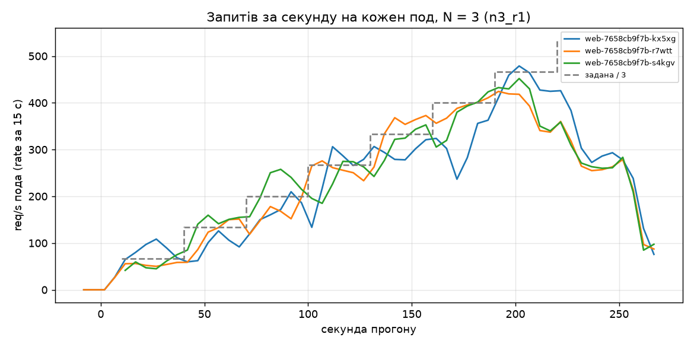
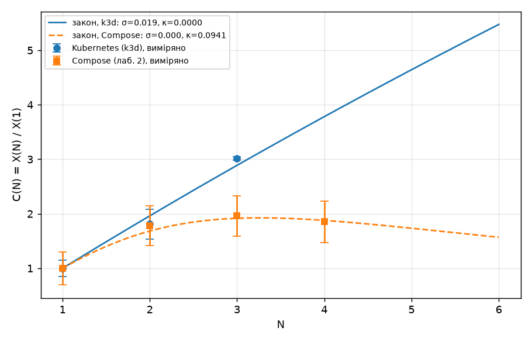
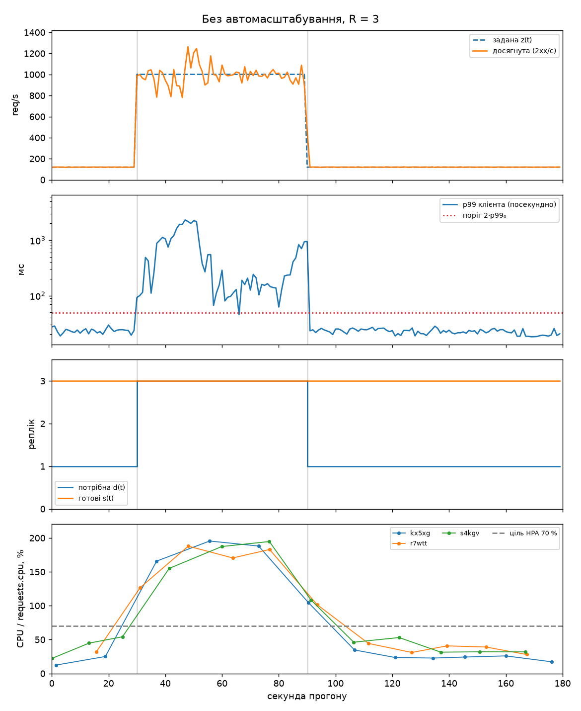
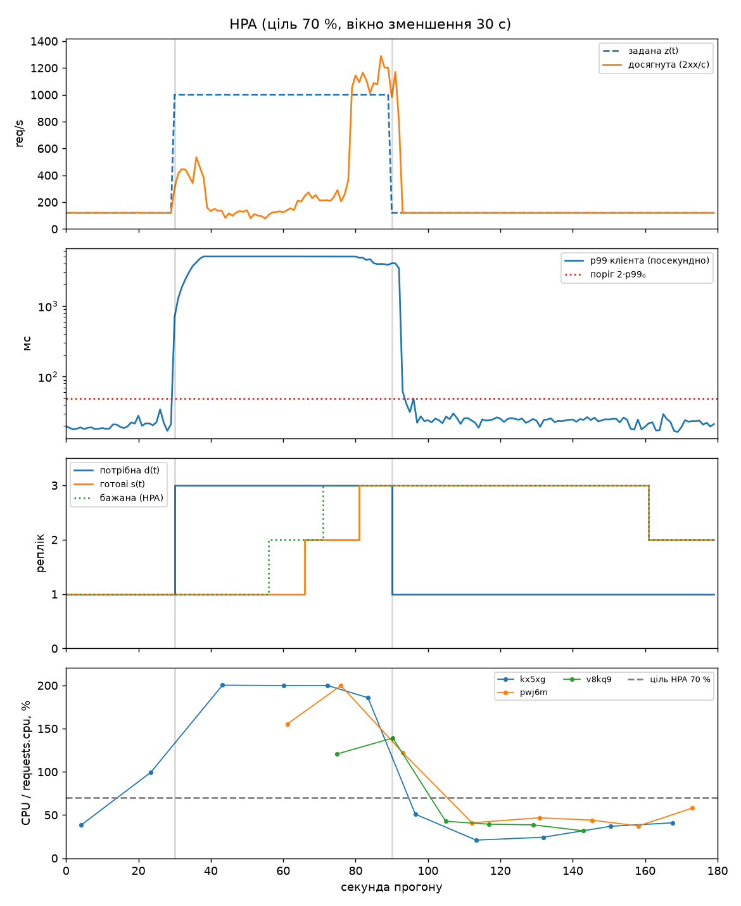

# Звіт. Лабораторна робота 3: сервіс у Kubernetes з автомасштабуванням і без нього (варіант 12)

Продовження лабораторних 1 і 2: той самий сервіс `/admissions` (FastAPI + PostgreSQL), той самий генератор `loadgen/stepload.py` і той самий аналіз закону масштабованості.
Параметри варіанта 12: R = 3 + (12 mod 3) = **3**, кластер **k3d**, CPU requests / limits **250m / 500m**, ціль HPA **70 %**, рівень стрибка **2,5·X(1)**, додаткова вимога **Д2**. Розмір пулу з лабораторної 2: **5**.

Умови вимірювань: той самий ноутбук, що й у лабораторній 2 (Windows 11, Intel Core i5-10300H, 4 ядра / 8 потоків, ОЗП 8 ГБ). Docker Desktop 29.9.2 бачить 8 CPU і 3,75 ГіБ памʼяті, cgroup v2; k3d 5.9.0, образ вузлів `rancher/k3s:v1.31.2-k3s1`, kubectl 1.36.1, Python 3.14.5.
Генератор і весь кластер працюють на одному ноутбуці.
Третій прогін N = 3 спершу збігся в часі з дзвінком Zoom і дав X = 998 req/s; я його повторила вже без Zoom (1199 req/s), у таблицях лише повторний прогін.

Сирі результати: `results/lab3/`, автоматичний підсумок: `results/lab3/summary_lab3.md` (`python scripts/analyze_lab3.py`), діаграми: `results/lab3/figs/`. Порядок команд: `README_LAB3.md`.

## 1. Кластер і команда розгортання (кроки 1-2)

`k3d/cluster.yaml`: один server і два agent; на server taint `node-role.kubernetes.io/control-plane=true:NoSchedule`, тому поди web розміщуються лише на agent. Балансувальник k3d вимкнено, порти NodePort прокинуто напряму на server: 8080 → 30080 (web), 9090 → 30090 (Prometheus). Traefik і servicelb вимкнені (Ingress у варіанті 12 не потрібен).

```yaml
apiVersion: k3d.io/v1alpha5
kind: Simple
metadata:
  name: lab3
servers: 1
agents: 2
image: rancher/k3s:v1.31.2-k3s1
ports:
  - port: 8080:30080          # Service web (NodePort)
    nodeFilters: [server:0:direct]
  - port: 9090:30090          # Prometheus (NodePort)
    nodeFilters: [server:0:direct]
options:
  k3d:
    wait: true
    disableLoadbalancer: true
  k3s:
    extraArgs:
      - arg: --node-taint=node-role.kubernetes.io/control-plane=true:NoSchedule
        nodeFilters: [server:0]
      - arg: --disable=traefik
        nodeFilters: [server:0]
      - arg: --disable=servicelb
        nodeFilters: [server:0]
      - arg: --kubelet-arg=cpu-cfs-quota=true
        nodeFilters: [server:*, agent:*]
```

Спершу порти були задані як `nodeFilters: [server:0]`; k3d 5.9 тоді відмовився створювати кластер з помилкою `port-mapping of type 'proxy' specified, but loadbalancer is disabled`, тому тип `direct` вказано явно.

Команда розгортання `python scripts/k8s_up.py`: `k3d cluster create --config k3d/cluster.yaml` → `kubectl label node k3d-lab3-server-0 role=infra` → `docker build -t admissions-web:lab3 .` → `k3d image import admissions-web:lab3 -c lab3` → Secret з `.env` → ConfigMap зі схемою (`db/init.sql`) і запитами експортера (`postgres-exporter/queries.yaml`) → база → Job міграції → web → моніторинг. Повне розгортання з нуля на ноутбуці тривало 195 с. Повне видалення: `python scripts/k8s_down.py` (`k3d cluster delete lab3`).

| файл | вміст |
|---|---|
| `k8s/db.yaml` | ConfigMap `db-config` (`MAX_CONNECTIONS: "100"`), headless Service `db`, StatefulSet `db` з PVC 1 Gi, nodeSelector `role: infra` і toleration |
| `k8s/migrate-job.yaml` | Job `migrate`: чекає `pg_isready`, виконує `psql -f /migrations/init.sql` |
| `k8s/web.yaml` | ConfigMap `web-config`, Deployment `web` без `replicas`, Service NodePort 30080 |
| `k8s/hpa.yaml` | HPA (лише для кроку 11) |
| `k8s/monitoring/*.yaml` | Prometheus, kube-state-metrics, postgres-exporter (усі на `role: infra`) |

## 2. База (крок 3)

StatefulSet `db` (postgres:16-alpine) на вузлі `k3d-lab3-server-0`, `max_connections` передається аргументом `-c max_connections=$(MAX_CONNECTIONS)` з ConfigMap. Пароль бере з Secret `db-secret`, який створює `k8s_up.py` з файла `.env` (у репозиторії `.env` немає). Схему накочує Job `migrate`.

Перевірка `python scripts/run_lab3.py db-persist`: я створила запис через API, видалила под `kubectl delete pod db-0`, StatefulSet створив под заново (новий uid), той самий PVC `data-db-0` → PV `pvc-e5d1629c-…`. Після цього `GET /admissions/1` повернув 200 і той самий запис; `/healthz` сервісу знову відповів 200 через 4,8 с після видалення.

## 3. Сервіс web (крок 4)

```yaml
apiVersion: apps/v1
kind: Deployment
metadata:
  name: web
  namespace: lab3
spec:
  selector:
    matchLabels:
      app: web
  template:
    metadata:
      labels:
        app: web
    spec:
      terminationGracePeriodSeconds: 15
      containers:
        - name: web
          image: admissions-web:lab3
          imagePullPolicy: IfNotPresent
          ports:
            - name: http
              containerPort: 8000
          envFrom:
            - configMapRef:
                name: web-config        # DB_HOST, DB_PORT, DB_NAME, DB_USER, DB_POOL_SIZE=5
          env:
            - name: DB_PASSWORD
              valueFrom:
                secretKeyRef: {name: db-secret, key: POSTGRES_PASSWORD}
            - name: POD_NAME
              valueFrom:
                fieldRef: {fieldPath: metadata.name}
          resources:
            requests: {cpu: 250m}
            limits: {cpu: 500m, memory: 512Mi}
          readinessProbe:
            httpGet: {path: /healthz, port: http}
            timeoutSeconds: 3
            periodSeconds: 5
            failureThreshold: 3
          livenessProbe:
            httpGet: {path: /livez, port: http}
            timeoutSeconds: 3
            periodSeconds: 10
            failureThreshold: 3
          lifecycle:
            preStop:
              sleep: {seconds: 5}
```

Service `web` типу NodePort (30080). Код сервісу не змінювався: `POD_NAME` уже використовувався для заголовка `X-Pod` у лабораторній 2.

Перевірка `python scripts/run_lab3.py crud` на 3 репліках через `localhost:8080` (кожен запит на новому зʼєднанні):

| крок | запит | код | X-Pod | вузол |
|---|---|---|---|---|
| Створення | `POST /admissions` | 201 | `web-7658cb9f7b-kx5xg` | agent-1 |
| Читання | `GET /admissions/2` | 200 | `web-7658cb9f7b-vq8lj` | agent-0 |
| Заміна | `PUT /admissions/2` | 200 | `web-7658cb9f7b-kx5xg` | agent-1 |
| Читання після заміни | `GET /admissions/2` | 200 | `web-7658cb9f7b-b29sl` | agent-0 |
| Видалення | `DELETE /admissions/2` | 204 | `web-7658cb9f7b-b29sl` | agent-0 |
| Читання видаленого | `GET /admissions/2` | 404 | `web-7658cb9f7b-kx5xg` | agent-1 |

Пошук пароля (той самий скрипт): його немає в ConfigMap простору `lab3`, у `docker image inspect` і `docker history` образу, у файлах під контролем git і в специфікації Deployment; Deployment бере пароль через `secretKeyRef`.

## 4. Моніторинг (крок 5)

Звичайні маніфести без Helm (`k8s/monitoring/`), усі поди на `role=infra`:
- Prometheus v2.55.1, `scrape_interval: 5s`; job `web` знаходить поди через `kubernetes_sd_configs` (role pod, мітка `app=web`, порт 8000) і додає мітки `pod` і `node`;
- job `cadvisor` збирає `/metrics/cadvisor` кожного вузла через проксі API-сервера (`/api/v1/nodes/<вузол>/proxy/metrics/cadvisor`), залишаю лише лічильники CPU/CFS і памʼять контейнерів простору `lab3`;
- kube-state-metrics v2.13.0 (`--resources=deployments,pods,horizontalpodautoscalers,nodes`);
- postgres-exporter v0.15.0 із запитом `pg_connections` з лабораторної 2.

metrics-server входить до k3s, окремо не встановлювався.

Перевірка `python scripts/run_lab3.py monitoring` (3 репліки, 30 с навантаження 100 req/s):

| ряд | рядів | значення |
|---|---|---|
| `http_requests_total` за подами | 3 | 976, 852, 1176 |
| `container_cpu_cfs_periods_total{container="web"}` | 3 | 600, 421, 414 |
| `container_cpu_cfs_throttled_periods_total{container="web"}` | 3 | 32, 34, 34 |
| `kube_deployment_status_replicas_ready{deployment="web"}` | 1 | 3 |
| `pg_connections_count` | 2 | idle 15, active 1 |

`kubectl top pods` повертає дані (web 30-77m CPU, близько 50 МіБ). Годинники Prometheus і генератора збігаються (різниця 0,00 с), тож ряди Prometheus можна зіставляти із секундами генератора.

cAdvisor оновлює лічильники CFS раз на 10-15 с і віддає їх із власними мітками часу; у першій версії скрипта `rate`/`increase` за 20-секундне вікно для частини сходинок повертали порожній результат. Частку дроселювання я рахую із сирих зразків лічильників: приріст `throttled` / приріст `periods` між першим і останнім зразком у вікні сходинки (якщо в ньому менше двох зразків, вікно розширюється до ±15 с).

## 5. Генератор: модель зʼєднань (крок 6)

До `loadgen/stepload.py` додано режим `--conns K --reqs-per-conn M`: генератор тримає K = 8·R = 24 постійні зʼєднання (поділені між процесами), кожне закривається після 100 запитів і замість нього відкривається нове. Запит, для якого немає вільного зʼєднання, чекає в черзі генератора; затримка, як і раніше, рахується від запланованого моменту відправки, а запит, що не завершився за 5 с, рахується відповіддю не 2xx. Сходинка триває 30 с, середнє беремо за останні 20 с (`--step-duration 30 --transient 10 --window 20`); профіль сходинок той самий, що в лабораторній 2 (прогрів 10 с на 200 req/s, далі від 200 з кроком 200).
Без `--conns` генератор працює як у лабораторній 2.

## 6. X(N) без автомасштабування (крок 7)

`python scripts/run_lab3.py steps --replicas N [--run K]` (перед прогоном `kubectl scale deployment/web --replicas=N`, очікування N готових подів і N цілей у Prometheus).

| N | прогін | X(N), req/s | розкид у вікні | сходинка (задана) | точка досягнута | p99 клієнта, мс | p99 сервера | дроселювання: середнє / найбільше | не 2xx |
|---|---|---|---|---|---|---|---|---|---|
| 1 | n1_r1 | 400,4 | 59,7 | 2 (400) | так | 595,8 | 206,6 мс | 70,1 % / 70,1 % | 0,00 % |
| 2 | n2_r1 | 724,4 | 109,8 | 4 (800) | так | 3479,4 | 121,8 мс | 100,0 % / 100,0 % | 0,00 % |
| 3 | n3_r1 | 1223,5 | 119,2 | 6 (1200) | так | 4607,8 | 82,3 мс | 89,8 % / 100,0 % | 0,07 % |
| 3 | n3_r2 | 1199,5 | 180,5 | 6 (1200) | так | 2252,2 | 85,7 мс | 81,2 % / 100,0 % | 0,00 % |
| 3 | n3_r3 | 1198,7 | 161,9 | 6 (1200) | так | 4189,9 | 105,5 мс | 90,1 % / 92,6 % | 0,00 % |

Підсумок: **X(1) = 400,4** (±59,7 у вікні), **X(2) = 724,4** (±109,8), **X(3) = 1207,2** (±14,1 між трьома прогонами). Усі прогони зупинились за правилом «двічі поспіль досягнута < 0,9 заданої», тобто всі точки досягнуті. X(2) лежить на межі: на сходинці 800 досягнуто 724 (0,905 заданої).

X(1) = 400 приблизно вдвічі менше за X(1) = 808 у Compose, де контейнер мав ліміт 1 CPU, а тут 0,5 CPU. На сходинці X(1) под дроселюється в 70 % періодів CFS, на N = 2 у 100 %.
p99 клієнта (сотні мілісекунд - секунди) набагато більший за p99 сервера (80-210 мс): у клієнтську затримку входить очікування вільного з'єднання з 24 у черзі генератора, а також шлях через Docker і kube-proxy. Ці складники окремо я не розділяла.

## 7. Дисбаланс навантаження (крок 8)

I = X_max / X_avg на сходинці X(N), req/s пода з `increase(http_requests_total[20s]) / 20` у кінці вікна:

| N | прогін | req/s за подами (под@вузол) | I | найзавантаженіший: p99 сервера / дроселювання | найменш завантажений: p99 сервера / дроселювання |
|---|---|---|---|---|---|
| 2 | n2_r1 | kx5xg@agent-1 358, r7wtt@agent-0 368 | 1,014 | 124,2 мс / 100,0 % | 118,2 мс / 100,0 % |
| 3 | n3_r1 | kx5xg@agent-1 396, r7wtt@agent-0 414, s4kgv@agent-0 421 | 1,026 | 80,4 мс / 86,2 % | 54,1 мс / 83,2 % |
| 3 | n3_r2 | kx5xg@agent-1 398, r7wtt@agent-0 449, s4kgv@agent-0 378 | 1,099 | 105,6 мс / 100,0 % | 76,1 мс / 73,8 % |
| 3 | n3_r3 | kx5xg@agent-1 428, r7wtt@agent-0 368, s4kgv@agent-0 360 | 1,110 | 105,4 мс / 92,1 % | 117,7 мс / 85,7 % |

I від 1,01 до 1,11 (найбільше можливе значення 3): розподіл майже рівний. Генератор кожні 100 запитів відкриває нове зʼєднання, а kube-proxy обирає под саме під час встановлення зʼєднання, тож зʼєднання часто перерозподіляються. Два поди з трьох були на `agent-0`, один на `agent-1`; помітної переваги поду на окремому вузлі немає (у n3_r1 він найменш завантажений, у n3_r3 найзавантаженіший). Найзавантаженіший под переважно має більшу частку дроселювання; p99 сервера в n3_r3 виявився більшим у найменш завантаженого пода, тобто однозначного звʼязку p99 з навантаженням пода за цими даними немає.

Діаграма запитів за секунду кожного пода (N = 3, прогін n3_r1): `results/lab3/figs/pods_rps_R.png`; посекундні діаграми прогонів: `results/lab3/figs/timeline_n*_r*.png`.



## 8. Універсальний закон масштабованості (крок 9)

Ті самі формули МНК без вільного члена, що й у лабораторній 2 (`scripts/usl.py`).

| стенд | λ = X(1) | C(2) | C(3) | C(4) | σ | κ | N* |
|---|---|---|---|---|---|---|---|
| Kubernetes (k3d, 0,5 CPU на под) | 400,4 | 1,809 | 3,015 | — | 0,0192 | 0 | не визначене (κ = 0) |
| Compose (лабораторна 2, 1 CPU на контейнер) | 808,2 | 1,780 | 1,962 | 1,854 | 0 | 0,0941 | 3,26 |

Для кластера оцінка κ вийшла відʼємною, тому за правилом прийнято κ = 0 і σ = Σuy / Σu² = 0,0192. Закон дає X(2) = 785,8 і X(3) = 1157,0 при виміряних 724,4 і 1207,2.



У кластері пропускна здатність росте майже лінійно до N = 3 (C(3) = 3,0), а в Compose вже на трьох екземплярах C = 1,96, і найбільше значення досягається близько N* ≈ 3,3. Різниця узгоджується з тим, скільки процесора забирає сервіс: у Compose чотири екземпляри по 1 CPU разом із генератором конкурували за 8 потоків ноутбука, а тут три поди разом мають не більше 1,5 CPU. Через межу 500m X(1) вдвічі менше, і машина ще не насичена при N = 3. Окремо цю гіпотезу я не перевіряла (наприклад, прогоном з більшим лімітом). Підбір у кластері зроблено за двома точками (N = 2, 3), тому N* для кластера визначити не можна: для цього потрібні N > 3, яких у варіанті немає.

## 9. Змінне навантаження: без автомасштабування і з HPA (кроки 10-12)

Профіль (`--profile`, відрізки «тривалість:інтенсивність»): 30 с на 0,3·X(1) = 120 req/s, 60 с на рівні стрибка, 90 с на 120 req/s. Рівень стрибка = min(2,5·X(1), 0,9·X(3)) = min(1001, 1086) = **1001 req/s**.

- Крок 10: `python scripts/run_lab3.py profile --mode fixed` на 3 репліках без HPA.
- Крок 11: `python scripts/run_lab3.py profile --mode hpa`: HPA з `k8s/hpa.yaml`, скрипт чекає, поки `kubectl get hpa` показує 1 поточну і 1 бажану репліку 60 с поспіль.

```yaml
apiVersion: autoscaling/v2
kind: HorizontalPodAutoscaler
metadata:
  name: web
  namespace: lab3
spec:
  scaleTargetRef: {apiVersion: apps/v1, kind: Deployment, name: web}
  minReplicas: 1
  maxReplicas: 3
  metrics:
    - type: Resource
      resource:
        name: cpu
        target: {type: Utilization, averageUtilization: 70}
  behavior:
    scaleDown:
      stabilizationWindowSeconds: 30
```

| прогін | відрізок | задана | досягнута | p99 клієнта, мс | не 2xx |
|---|---|---|---|---|---|
| без HPA | 1 | 120 | 120,0 | 24,3 | 0,00 % |
| без HPA | 2 | 1001 | 995,4 | 1818,2 | 0,00 % |
| без HPA | 3 | 120 | 123,7 | 594,0 | 0,00 % |
| HPA | 1 | 120 | 120,0 | 21,8 | 0,00 % |
| HPA | 2 | 1001 | 380,7 | 5015,5 | 60,25 % |
| HPA | 3 | 120 | 148,8 | 3900,3 | 0,00 % |

Часи для прогону з HPA (бажана кількість з `kube_horizontalpodautoscaler_status_desired_replicas`, готові з `kube_deployment_status_replicas_ready`, обидва ряди з кроком запиту 1 с):

| подія | час |
|---|---|
| від початку стрибка до першої зміни бажаної кількості реплік | 26 с |
| від початку стрибка до готовності найбільшої за прогін кількості реплік (3) | 51 с |
| від початку стрибка до моменту, після якого p99 клієнта 10 с поспіль < 1,2·1818,2 мс | не досягнуто |
| від кінця стрибка до першого зменшення кількості готових реплік | 71 с |

Метрики еластичності (T = 180 с; d(t) з виміряних X(1) = 400,4, X(2) = 724,4, X(3) = 1207,2: на 120 req/s d = 1, на 1001 req/s d = 3; p99₀ = 24,3 мс, поріг 2·p99₀ = 48,6 мс):

| прогін | θ_U | θ_O | a_U | a_O | W, репліко-с | секунд порушення порогу | не 2xx | помилки зʼєднання |
|---|---|---|---|---|---|---|---|---|
| без HPA | 0,000 | 0,667 | 0,000 | 1,333 | 540 | 60 | 0 | 0 |
| HPA | 0,283 | 0,500 | 0,483 | 0,894 | 374 | 65 | 34624 | 0 |




(Обидві діаграми з однаковими шкалами: задана і досягнута інтенсивність, p99 клієнта з порогом 2·p99₀, d(t), s(t) і бажана кількість реплік, CPU кожного пода відносно requests.cpu за сирими зразками cAdvisor.)

Висновки за вимірюваннями:
- Без HPA три репліки витримали стрибок без відмов (досягнуто 995 з 1001 req/s), але p99 клієнта на стрибку 1,8 с; поріг 48,6 мс перевищено в 60 секундах зі 180. Ціна: 540 репліко-секунд, із них дві третини часу (θ_O = 0,667) реплік більше, ніж потрібно.
- З HPA перша зміна бажаної кількості настала через 26 с після початку стрибка, а три готові репліки лише через 51 с, тобто за 9 с до кінця 60-секундного стрибка. До того одна-дві репліки отримували 1001 req/s при X(1) = 400; черга генератора росла, і 60 % запитів стрибка завершились тайм-аутом 5 с (34 624 відповіді не 2xx). p99 так і не повернувся нижче 1,2·1818 мс до кінця стрибка.
- Після стрибка HPA ще 71 с тримав три репліки (30 с з них це вікно стабілізації; решта, ймовірно, затримка метрик і циклу HPA), тому θ_O = 0,5. Разом HPA заощадив 31 % репліко-секунд (374 проти 540), але за рахунок нестачі реплік у 28 % часу і масових відмов під час стрибка.
- На третьому відрізку p99 обох прогонів за відрізок високий (594 мс без HPA, 3,9 с з HPA), хоча задана лише 120 req/s; ймовірно, це запити, що накопичились у черзі генератора за стрибок (досягнута на цьому відрізку вища за задану: 123,7 і 148,8 req/s).

## 10. Д2: нестача зʼєднань з базою (крок 13)

`python scripts/run_lab3.py d2` після кроку 12: `max_connections = 2·5 + 5 = 15` (ConfigMap `db-config`, перезапуск пода `db-0`; `SHOW max_connections` повернув 15). Далі N = 1, 2, 3 реплік по 40 с сталого потоку 0,7·X(N), потім ступінчастий прогін на R = 3 до і після виправлення. Виправлення: `DB_POOL_SIZE = ⌊(15 − 4) / 3⌋ = 3` у ConfigMap `web-config`. Повернення: `python scripts/run_lab3.py restore` (`max_connections = 100`, пул 5).

| N | задана | досягнута | не 2xx | помилки зʼєднання | p99 клієнта, мс | зʼєднань з базою (pg_stat_activity) | за postgres-exporter | помилок у журналі бази |
|---|---|---|---|---|---|---|---|---|
| 1 | 280 | 279,9 | 0 | 0 | 341,4 | 6 (web 5 + exporter 1) | 6 | 0 |
| 2 | 507 | 506,6 | 0 | 0 | 244,1 | 11 (web 5 + 5 + exporter 1) | 10 | 0 |
| 3 | 845 | 840,5 | 1 | 0 | 3949,2 | psql не підключився: `FATAL: sorry, too many clients already` | 14 | 47 |

Помилки зʼявляються з **N = 3**: трьом подам потрібно 3·5 = 15 зʼєднань плюс зʼєднання експортера, а база дозволяє 15. У журналі бази за 40 с 47 рядків `FATAL:  sorry, too many clients already`; навіть `psql` для перевірки не зміг підключитися, а postgres-exporter (рахує без власного зʼєднання) бачив 14 зʼєднань замість 15 потрібних подам. У генераторі на сталому потоці 0,7·X(3) майже без відмов (1 відповідь не 2xx), але p99 клієнта зріс до 3,9 с.

```
2026-11-25 10:09:20.105 UTC [533] FATAL:  sorry, too many clients already
2026-11-25 10:09:20.992 UTC [540] FATAL:  sorry, too many clients already
2026-11-25 10:09:21.179 UTC [541] FATAL:  sorry, too many clients already
```

Ступінчасті прогони на R = 3:

| R = 3 | DB_POOL_SIZE | X(3), req/s | зʼєднань з базою перед прогоном | не 2xx до кінця сходинки X / за весь прогін | помилок у журналі бази |
|---|---|---|---|---|---|
| max_connections = 100 (крок 7) | 5 | 1207,2 | — | 0-0,07 % на сходинці X | — |
| до виправлення (max_connections = 15) | 5 | 785,0 | psql не підключився; exporter: 14 | 0 / 28 298 | 159 |
| після виправлення | 3 | 1182,5 | pg_stat_activity: 10 (по 3 від кожного пода + exporter 1) | 2 650 / 36 455 | 0 |

До виправлення X(3) упала з 1207 до 785 req/s, а журнал бази містить 159 відмов у зʼєднанні за прогін. Після зменшення пулу до 3 відмов у журналі немає, кожен под тримає рівно 3 зʼєднання, і X(3) = 1182,5 близька до значення з кроку 7. Відповіді не 2xx за весь прогін в обох випадках здебільшого припадають на сходинки після X (перевантаження і тайм-аути генератора). Після виправлення 2 650 з них зʼявились ще до кінця сходинки X (сходинка 7, задана 1400): там досягнута вже нижча за задану.

Застосувати новий `DB_POOL_SIZE` звичайним `kubectl rollout restart` не вдалося: rollout не завершився за 120 с (`error: timed out waiting for the condition`). Ймовірна причина: новий под не може отримати жодного зʼєднання, поки старі поди займають усі 15 слотів, тож не проходить readinessProbe `/healthz`. Скрипт тоді перезапустив поди через `kubectl scale --replicas=0` і назад до 3. Після повернення `max_connections = 100` той самий `rollout restart` завершився нормально.

## 11. Відкинуті рішення

1. **Helm-чарти kube-prometheus-stack і prometheus-postgres-exporter.** Відхилено: мені потрібні лише кілька рядів (запити подів web, лічильники cAdvisor, стан Deployment і HPA, зʼєднання з базою), а звичайні маніфести (`k8s/monitoring/`) не потребують встановлення Helm.
2. **Балансувальник k3d (serverlb) перед NodePort.** Відхилено: додає ще один nginx у шлях запиту. Порти прокинуто напряму на server (`server:0:direct`).
3. **`rate`/`increase` для лічильників CFS за вікно сходинки.** Відхилено після першої спроби: для частини сходинок результат був порожній, бо cAdvisor оновлює лічильники раз на 10-15 с. Частку дроселювання рахую із сирих зразків (розділ 4).
4. **`kubectl rollout restart` для зміни пулу в Д2.** Не спрацював при `max_connections = 15` (розділ 10), використано scale 0 → 3.

## 12. Використання генеративних моделей

Модель (Claude) використана для: шаблону цього звіту.
Усі числа в розділах 2-10 взяті з моїх прогонів на ноутбуці (`results/lab3/`, `summary_lab3.md`).

## 13. Теги git

Стан лабораторної 3 позначено тегом `lab3` на коміті з цим звітом (`git show lab3`); теги `lab1` і `lab2` не змінювались.
