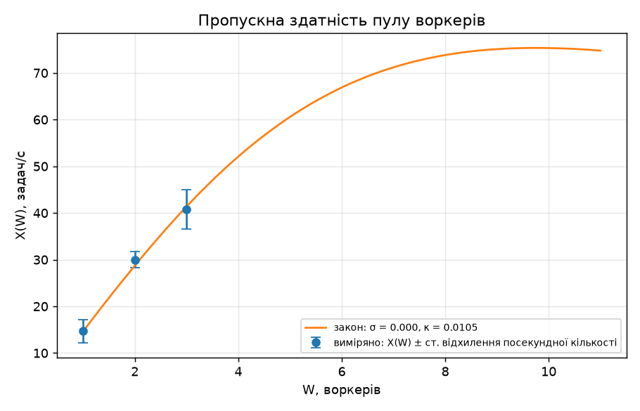
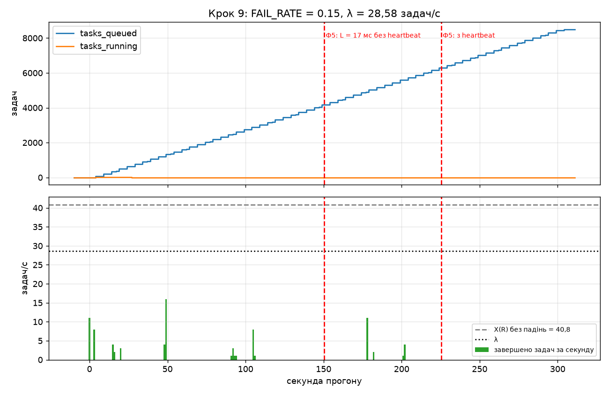

# Звіт. Лабораторна робота 4: синхронізація пула воркерів (варіант 12)

Продовження лабораторних 1-3: той самий сервіс `/admissions` (FastAPI + PostgreSQL) у кластері k3d з лабораторної 3 (простір імен `lab3`).
Параметри варіанта 12: q_lo / q_hi = **0,01 / 0,99**, T_poll = **50 мс**, L = **15 с**, сценарій відмови **Ф5**, додаткова вимога **Д4**, R = **3** (з лабораторної 3), S = 256.

Умови вимірювань: той самий ноутбук, що й у лабораторних 2-3 (Windows 11, Intel Core i5-10300H, 4 ядра / 8 потоків). Docker Desktop 29.9.2 бачить 8 CPU і 4,0 ГБ памʼяті; k3d 5.9.0, кластер `lab3` (1 server + 2 agent). Генератор, кластер і аналіз працюють на одному ноутбуці. Кожен прогін кроку 6 виконано один раз.

Сирі результати: `results/lab4/`, автоматичний підсумок: `results/lab4/summary_lab4.md` (`python scripts/analyze_lab4.py`), діаграми: `results/lab4/figs/`, журнали прогонів: `results/lab4/log_*.txt`. Порядок команд: `README_LAB4.md`.

## 1. Схема, ендпоінти, метрики (крок 1)

Міграція `db/002_tasks.sql` (виконує Job `migrate` після `init.sql`): таблиця `tasks` (id, record_id з FK на `admissions`, status, seed, attempts, max_attempts = 3, token = 0, lease_until, worker_id, created_at, started_at, finished_at; індекс `(status, created_at)`), таблиця `task_results` (task_id — первинний ключ, token, worker_id, result jsonb, created_at). Ще дві допоміжні таблиці: `task_events` — журнал воркерів у базі (stdout контейнера губиться після перезапусків, а `kubectl logs --previous` зберігає лише один попередній) і `worker_config` — перемикання режимів воркера без перезапуску подів.

| запит | код |
|---|---|
| `POST /admissions/{id}/tasks` (запис є) | 202, тіло задачі, `Location: /tasks/{id}` |
| `POST /admissions/999999999/tasks` | 404 |
| `GET /tasks/{id}` | 200 (задача і результат, якщо є) |
| `GET /tasks/999999999` | 404 |
| `GET /tasks?status=queued&limit=2&offset=0` | 200 |
| `GET /tasks?status=unknown` | 400 |

seed генерує сервіс (`random.randint(1, 2^31 − 1)`). У `/metrics` сервісу web є `tasks_queued` і `tasks_running`; фонове завдання оновлює їх запитом до бази кожні 5 с.

## 2. Воркер (крок 2)

`worker/worker.py`, образ `admissions-worker:lab4` (`worker/Dockerfile`), Deployment `worker` без `replicas` у `k8s/worker.yaml`: requests.cpu 250m, limits.cpu 500m, limits.memory 512Mi, terminationGracePeriodSeconds 30, `WORKER_ID` з імені пода через Downward API. Prometheus збирає поди `app=worker` (порт 9100). Метрики: `worker_tasks_total{result=done|failed|lost}`, `worker_claims_total{result=task|empty}`, `worker_task_duration_seconds{step=claim|fetch|process|store}`, `worker_tasks_in_flight`.

Обробка зрізу (`worker/slice_proc.py`) — лише цикли Python: генератор LCG, гістограма з 4096 рівнів, p_lo / p_hi за квантилями 0,01 / 0,99, вікно яскравості, середнє і стандартне відхилення.

20 задач на одному воркері (`run_lab4.py step2`):

| claim | fetch | process = t_cpu | store | t_io = fetch + store | 1 / (t_io + t_cpu + T_poll/2) |
|---|---|---|---|---|---|
| 0,87 мс | 2,17 мс | 34,69 мс | 2,98 мс | 5,14 мс | 15,42 задачі/с |

Результати воркера для трьох задач збіглися з локальним обчисленням за тим самим seed.

## 3. Наївне захоплення (крок 3)

SELECT найстаршої задачі `queued`, окремий UPDATE на `running`, без транзакції і блокувань; результат — INSERT без ON CONFLICT, первинний ключ `task_results` на час кроку замінено звичайним індексом. R = 3 воркери, 300 задач з інтенсивністю 100 задач/с.

| T_poll | задач з >1 результатом | D за `task_results` | D за журналом воркерів | рядків `task_results` |
|---|---|---|---|---|
| 50 мс | 25 | 8,33 % | 8,33 % | 325 |
| 1 мс | 14 | 4,67 % | 4,67 % | 316 |

Обидва способи підрахунку дали однакові числа. З T_poll = 1 мс дублів менше; ймовірне пояснення — з частим опитуванням воркери рідше прокидаються одночасно, але за одним прогоном на кожне значення це лише припущення.

## 4. Блокування рядка (крок 4)

Захоплення однією командою `UPDATE ... WHERE id IN (SELECT ... FOR UPDATE SKIP LOCKED) RETURNING`, первинний ключ повернуто. T_poll = 1 мс, та сама серія.

| захоплення | D | p50 / p99 захоплення | Lock у pg_stat_activity (раз на 1 с) | granted = false (раз на 1 с) | Lock за зрізами через 20 мс | транзакцій бази/с |
|---|---|---|---|---|---|---|
| FOR UPDATE SKIP LOCKED | 0 % | 0,57 / 2,01 мс | 0 | 0 | 0 | 889 |
| FOR UPDATE | 0 % | 0,45 / 2,36 мс | 0 | 0 | 1 | 864 |

Дублів немає в обох режимах. Очікування блокувань без SKIP LOCKED на R = 3 майже не видно: захоплення триває близько 0,5 мс, а задача — близько 40 мс, тож воркери рідко звертаються до черги одночасно. Секундні зрізи не застали жодного очікування, тому я додала зрізи через 20 мс: за весь прогін — один рядок з `wait_event_type = 'Lock'`. Кількість порожніх захоплень: 10 164 з SKIP LOCKED і 9 631 без нього, майже всі — опитування порожньої черги з T_poll = 1 мс.
Обмеження: у рядку FOR UPDATE лічильник показав 125 захоплень із задачею замість 300 (задач оброблено 300, D = 0). Ймовірно, один із зрізів `/metrics` воркерів через `kubectl exec` не відповів, тож p50 / p99 у цьому рядку пораховані не за всіма воркерами.

## 5. Lease, heartbeat, fencing token (крок 5)

L = 15 с, heartbeat кожні L/3 = 5 с з умовою `AND token = $token`, повернення спливлих задач у чергу кожним воркером перед захопленням (`... FOR UPDATE SKIP LOCKED`, щоб рядок, заблокований зупиненим воркером, не блокував інших), перехід у `failed` після `max_attempts`, запис результату `ON CONFLICT DO NOTHING` в одній транзакції із завершенням задачі за токеном.

Команда з умови `kubectl exec worker-… -- kill -STOP 1` повернула код 0, але стан процесу лишився `S (sleeping)`: воркер у контейнері є PID 1, і ядро не доставляє йому SIGSTOP зсередини його простору PID. Тому скрипт надсилає сигнал з вузла k3d: `docker exec k3d-lab3-agent-0 kill -STOP 6239` (PID з `crictl inspect`) → `T (stopped)`. Воркер був зупинений 30,9 с (2·L), далі `kill -CONT`.

| задача | attempts до / після | token до / після | статус | завершив | рядків `task_results` |
|---|---|---|---|---|---|
| 65 | 1 / 2 | 1 / 2 | done | `worker-5fb75f8c4-pk5gx` | 1 |

Події задачі в журналі: `claim` (зупинений воркер, token 1) → `reaped` (інший воркер, через 15 с) → `claim` (token 2) → `done` (token 2) → `stale` (зупинений воркер після відновлення). Рядок журналу зупиненого воркера:

```
{"t": 1795613622.13, "worker": "worker-5fb75f8c4-9bkn4", "event": "stale", "task": 65, "token": 1, "stage": "store", "rows": 0}
```

## 6. Пропускна здатність пулу (крок 6)

Перед прогоном черга заповнюється при 0 воркерах, далі `kubectl scale deployment/worker --replicas=W`. X(W) — середня кількість завершених задач за секунду за останні 30 с до спорожнення черги, розкид — стандартне відхилення посекундних значень. Відхилення від умови: 400 задач на W = 3 обробились би приблизно за 10 с, тому розмір черги скрипт збільшує так, щоб прогін тривав щонайменше 45 с (700, 1400, 2100 задач).

| W | X(W), задач/с | розкид | C(W) | p99 захоплення | транзакцій бази/с | CPU бази, ядер |
|---|---|---|---|---|---|---|
| 1 | 14,67 | 2,48 | 1,000 | 14,40 мс | 111 | 0,070 |
| 2 | 30,00 | 1,76 | 2,045 | 7,07 мс | 208 | 0,113 |
| 3 | 40,83 | 4,23 | 2,784 | 7,51 мс | 280 | 0,148 |

X(1) = 14,67 задачі/с проти 1 / (t_io + t_cpu + T_poll/2) = 15,42 задачі/с за кроком 2. У цьому прогоні крок обробки тривав у середньому 52,2 мс замість 34,7 мс у кроці 2: під безперервним навантаженням воркер упирається в ліміт 500m. Водночас з непорожньою чергою воркер не чекає T_poll між задачами. За тривалостями кроків цього ж прогону 1 / (claim + fetch + process + store) = 16,23 задачі/с.

Закон масштабованості (N → W): σ вийшла відʼємною і прирівняна до 0, κ = 0,01052, W* = 9,7. Через три точки й один прогін на кожну оцінка груба. База на W = 3 використовує 0,15 ядра і 280 транзакцій/с, тож у межах R = 3 вона не обмежує пул.



## 7. Закон Літтла (крок 7)

R = 3, λ = 0,7·X(R) = 28,58 задачі/с протягом 180 с, вікно — останні 120 с.

| λ, задач/с | W_q | λ·W_q | L_q з `tasks_queued` | L_q за таблицею `tasks` |
|---|---|---|---|---|
| 28,575 | 13,8 мс | 0,394 | 0,958 | 0,394 |

L_q за таблицею — середня за часом кількість задач між `created_at` і `started_at`; з λ·W_q вона збігається з точністю до округлення. Вимірювач `tasks_queued` дав L_q у 2,4 раза більше: черга майже весь час містить 0-1 задачу, значення знімаються раз на 5 с трьома подами web, а запит бере максимум за подами. Ймовірно, через це рідкісні ненульові зрізи переважають. W_q = 13,8 мс менше за T_poll/2 = 25 мс: з трьох воркерів задачу забирає той, чий наступний опит настає першим (p50 11,9 мс, p99 44,0 мс).

λ = 1,3·X(R) = 53,08 задачі/с протягом 120 с: черга на кінець 1014 задач (`tasks_queued`: 1018). Очікуваний приріст (λ − X(R))·120 = 1470; менший фактичний приріст відповідає пропускній здатності близько 44,6 задачі/с у цьому прогоні (у Д4 з b = 1 вийшло 43,93). W_q перших 100 задач 226 мс, останніх 100 — 22,74 с.

## 8. Коректна зупинка (крок 8)

Після SIGTERM воркер перестає захоплювати задачі, завершує поточну, повертає незапочаткований залишок пакета (`UPDATE ... SET status = 'queued' WHERE id = $1 AND token = $2`) і виходить з кодом 0. Якщо задача не встигає до кінця terminationGracePeriodSeconds (мінус 5 с запасу), окремий потік повертає її в чергу і завершує процес.

`kubectl rollout restart deployment/worker` під навантаженням 0,7·X(R):

| коди завершення контейнерів | повернуто в чергу | failed | задач з >1 результатом | attempts > 1 | rollout |
|---|---|---|---|---|---|
| 0, 0, 0 | 0 | 0 | 0 | 0 | 3,2 с |

## 9. FAIL_RATE = 0,15 і сценарій Ф5 (крок 9)

`FAIL_RATE: "0.15"` у Deployment, R = 3, λ = 0,7·X(R) = 28,58 задачі/с, 300 с. Посередині прогону (150 с) почався Ф5: L = t_cpu/2 = 17,3 мс без heartbeat, з 225 с — з heartbeat (через `worker_config`, без перезапуску).

| показник | значення |
|---|---|
| перезапусків контейнерів worker (RESTARTS) | 15, по 5 на кожен под |
| завершено задач за прогін | 81 з 4300 створених до середини |
| X у прогоні / X(R) без падінь | 0,27 / 40,83 задачі/с |
| attempts > 1 серед завершених | 16 з 81 = 19,8 % (очікувано f = 15 %) |
| failed | 0 (очікувано f³ = 0,34 %, тобто 0,3 задачі з 81) |
| задач з >1 результатом | 0 |
| черга на кінець прогону | 8492 queued |

Розподіл завершених задач за attempts: 1 — 65, 2 — 15, 3 — 1.

Пул майже не працював. Задача триває близько 40 мс, тож за f = 0,15 воркер падає приблизно після кожних 7 задач, тобто щосекунди. Kubelet перезапускає контейнер, що падає, з наростаючою паузою (10, 20, 40, 80, 160 с), тож за 300 с кожен под перезапустився лише 5 разів і майже весь час чекав. Задачі фаз Ф5 до кінця прогону навіть не дійшли до обробки (черга FIFO за `created_at`), тому Ф5 у цьому прогоні нічого не показав. Після повернення `FAIL_RATE = 0` (нові поди) черга дообробилась за 192 с, задач з двома результатами — 0.



Тому Ф5 я виконала ще й окремими прогонами по 60 с без падінь (`FAIL_RATE = 0`, тож від FAIL_RATE очікувана частка attempts > 1 дорівнює 0), λ = 0,7·X(R), L = 17,3 мс:

| прогін | задач | attempts > 1 | failed (вичерпано 3 спроби) | рядків «0 оновлених рядків» (heartbeat / store) | повернуто за lease | задач з >1 результатом |
|---|---|---|---|---|---|---|
| без heartbeat | 1714 | 1240 (72,3 %) | 857 | 3135 (0 / 3135) | 3135 | 0 |
| з heartbeat | 1714 | 804 (46,9 %) | 226 | 2970 (1521 / 1449) | 1452 | 0 |

Без heartbeat lease спливає посеред обробки, інший воркер повертає задачу в чергу, і запис старого власника оновлює нуль рядків. Heartbeat кожні L/3 ≈ 5,8 мс зменшив кількість задач з повторними захопленнями з 72 % до 47 %, але не прибрав їх. Ймовірна причина: квота CFS 500m може зупиняти весь контейнер (разом із потоком heartbeat) на десятки мілісекунд, а це довше за L. В обох прогонах кожна задача має не більше одного результату.

## 10. Д4: захоплення пакетом (крок 10)

`LIMIT b` у підзапиті захоплення; воркер виконує пакет по одній задачі, heartbeat продовжує всі задачі пакета. R = 3, черга заповнена заздалегідь; SIGTERM — окремим прогоном (`rollout restart` через 8 с після старту).

| b | X(R), задач/с | розкид | p50 / p99 захоплення | захоплень із задачами / порожніх | повернуто в чергу після SIGTERM | коди завершення | attempts > 1 |
|---|---|---|---|---|---|---|---|
| 1 | 43,93 | 3,30 | 1,52 / 3,91 мс | 2006 / 105 | 0 | 0, 0, 0 | 0 |
| 10 | 38,23 | 4,82 | 2,07 / 34,03 мс | 199 / 82 | 12 | 0, 0, 0 | 12 |

З b = 10 захоплень у 10 разів менше, але X(R) не зросла, а знизилась на 13 %. p99 захоплення зросла до 34 мс. Ймовірна причина: під кінець черги один воркер тримає до 9 задач, поки інші простоюють. Після SIGTERM з b = 10 воркери повернули в чергу 12 незапочаткованих задач, і всі вони отримали attempts > 1. З b = 1 нічого не повертається, бо поточна задача встигає завершитися.

## 11. Відкинуті рішення

1. **`kubectl exec ... kill -STOP 1` для кроку 5.** Не діє на PID 1 у контейнері (розділ 5). Сигнал надсилається з вузла k3d за PID процесу з `crictl inspect`.
2. **Лише секундні зрізи `pg_stat_activity` у кроці 4.** Не застали жодного очікування, тому додано зрізи через 20 мс (блок `DO` у самій базі).
3. **`increase()` у Prometheus для лічильників воркера за коротку серію.** Серія кроків 3-4 триває 5-10 с за інтервалу збору 5 с, а з T_poll = 1 мс порожні захоплення від простою спотворили б різницю. Тому скрипт читає `/metrics` кожного пода до і після серії.
4. **400 задач у кроці 6.** На W = 3 черга спорожніла б швидше, ніж за 30 с вікна; розмір черги збільшено (розділ 6).
5. **Ф5 лише посеред прогону з FAIL_RATE = 0,15.** Через паузи перезапусків задачі фаз Ф5 не дійшли до обробки, тому додано окремі прогони без падінь (розділ 9).

## 12. Використання генеративних моделей

Модель (Claude) використана для: шаблону цього звіту. Усі числа в розділах 1-10 взяті з `results/lab4/`.

## 13. Теги git

Стан лабораторної 4 позначено тегом `lab4` на коміті з цим звітом (`git show lab4`); теги `lab1`-`lab3` не змінювались.
