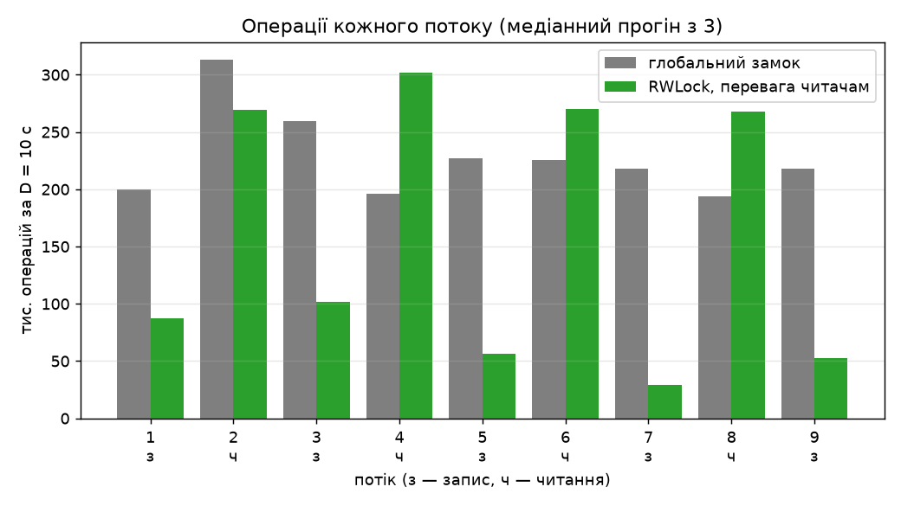
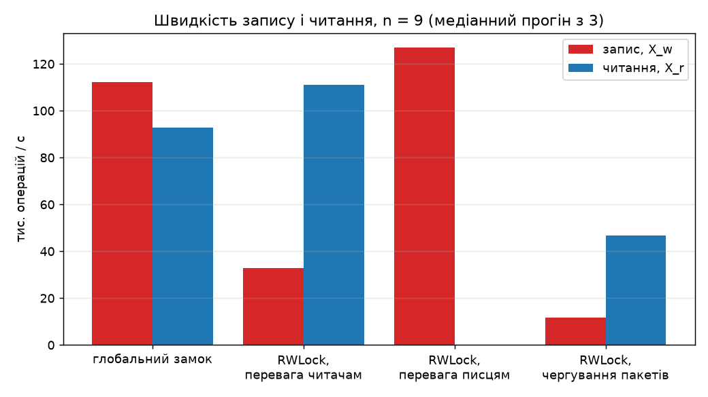
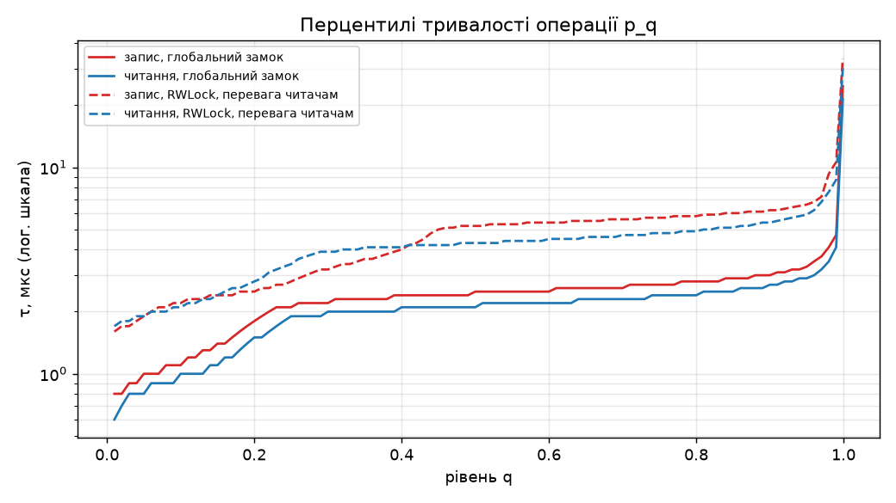

# Звіт. Лабораторна робота 5: потокобезпечна структура даних (варіант 12)

Продовження лабораторних 1-4: кеш результатів для записів `/admissions` за `record_id`. Варіант 12: структура **С2**
(хеш-таблиця кешу результатів за `record_id`), ключі **0…9999**, **n = 9** потоків: n_w = 5 записують (потоки 1, 3, 5, 7, 9),
n_r = 4 читають (2, 4, 6, 8). Перед кожним прогоном таблиця заповнена половиною простору ключів (5000 випадкових ключів).

Умови вимірювань: той самий ноутбук, що й у лабораторних 2-4 (Windows 11, Intel Core i5-10300H, 4 ядра / 8 логічних),
Python 3.14.5 (CPython, GIL увімкнено, `sys.getswitchinterval()` = 5 мс), таймер `perf_counter` (QueryPerformanceCounter,
роздільність 0,1 мкс). На час замірів я зупинила кластер k3d `lab3`, інших контейнерів не було. Кожен прогін: прогрів 1 с,
вимірювання D = 10 с, кожен вимір в окремому процесі Python, 3 повтори. Повтори йшли по черзі (глобальний замок, RWLock
трьох політик, далі наступний повтор), щоб дрейф машини однаково впливав на всі способи.

У таблицях 2-4, 6, 7 я беру медіанний прогін: з трьох прогонів той, у якого сумарне X медіанне, і всі показники рядка з нього.
Так X_w + X_r = X, а операції потоків у таблиці 4 сходяться з таблицями 2-3 (медіана окремо по кожній колонці цього не дає).
X_1 і t_cs — медіана трьох окремих вимірів. Усі прогони наведено в кінці звіту.

Сирі результати: `results/lab5/*.json`, журнал: `results/lab5/log_run.txt`, автоматичний підсумок: `results/lab5/summary_lab5.md`
(`python scripts/analyze_lab5.py`), діаграми: `results/lab5/figs/`. Порядок команд: `README_LAB5.md`.

## 1. Структура і стенд (крок 1)

**Хеш-таблиця** (`rwcache/table.py`) написана без готових колекцій: масив кошиків (список Python), у кожному кошику однозвʼязний
ланцюжок вузлів `[ключ, значення, наступний]`. Індекс кошика — перемішаний множенням Кнута ключ за маскою. Коли кількість ключів
перевищує 0,75 від кількості кошиків, масив подвоюється (за прогін було 10 розширень, від 16 кошиків). `put(k, v)` замінює значення
наявного ключа або додає вузол на початок ланцюжка; `get(k)` лише проходить ланцюжок.

Значення в кеші — «результат» `(record_id, номер потоку, номер запису цього потоку)`, за аналогією з `task_results` з лабораторної 4.
Кожен писець зберігає журнал ключів своїх записів, тож після прогону для будь-якого значення можна перевірити, що його справді
записав цей потік для цього ключа.

**Стенд** (`rwcache/bench.py`): потоки 1…9 стартують з барʼєра, непарні виконують лише `put`, парні лише `get`, без пауз; ключ
генерується в потоці до виклику (`random.Random` свого потоку, рівномірно 0…9999). Для кожної операції стенд бере t_call до
захоплення замка, t_acq після захоплення і t_ret після звільнення. У вимір іде операція, у якої t_call потрапив у вікно
[прогрів, прогрів + D). Очікування замка рахується в межах того самого вікна і для операцій, що почались у прогріві чи закінчились
після нього: інакше потік, який увесь вимір простояв на одному захопленні, не дав би жодного t_wait (це я помітила на пробному
прогоні з перевагою писцям). Спосіб синхронізації задає `--lock global|rw` і `--policy`.

Режими: `run` (n потоків), `x1` (один потік по черзі W R W R W R W R W, тобто 5 : 4, під тим самим замком), `tcs` (t_cs,w і t_cs,r
одним потоком), `readonly` (лише 4 читачі, порівняння всіх полів таблиці до і після).

**Інваріанти** після кожного прогону: (1) кількість вузлів дорівнює `size()`, кожен вузол лежить у своєму кошику, ключі не
повторюються; (2) кожне значення в таблиці і кожне 64-те непорожнє значення, яке повернув `get`, записано саме для цього ключа
(за журналами писців); `get` ні разу не повернув значення іншого ключа; (3) `size()` дорівнює кількості різних ключів, записаних
хоча б раз (заповнення + усі `put`).

Таблиця 1. Стенд

| n | n_w | n_r | Мова і версія | Логічних ядер | X_1, оп/с | Інваріанти після прогонів кроків 2 і 3 |
|---|---|---|---|---|---|---|
| 9 | 5 | 4 | Python 3.14.5 (CPython, GIL) | 8 | 821 191 (глобальний замок), 443 082 (RWLock) | виконано в 12 з 12 прогонів |

Перевірка інваріантів за прогонами:

| спосіб | прогін | структура | значень у таблиці, яких ніхто не записував | get повернув значення іншого ключа | перевірено значень get / з них не записаних | size() / різних записаних ключів |
|---|---|---|---|---|---|---|
| глобальний замок | 1 / 2 / 3 | ok | 0 | 0 | 17 557 / 0, 20 654 / 0, 16 636 / 0 | 10 000 / 10 000 |
| RWLock, перевага читачам | 1 / 2 / 3 | ok | 0 | 0 | 24 251 / 0, 20 627 / 0, 20 421 / 0 | 10 000 / 10 000 |
| RWLock, перевага писцям | 1 / 2 / 3 | ok | 0 | 0 | 311 / 0, 322 / 0, 0 / 0 | 10 000 / 10 000 |
| RWLock, чергування пакетів | 1 / 2 / 3 | ok | 0 | 0 | 8 191 / 0, 7 814 / 0, 8 077 / 0 | 10 000 / 10 000 |

За 10 с писці встигають записати всі 10 000 ключів, тому size() у кінці щоразу 10 000.

## 2. Глобальний замок (крок 2)

`GlobalLock` у `rwcache/locks.py`: один `threading.Lock`, його захоплюють і `put`, і `get` на весь час роботи з таблицею.

Таблиця 2. Глобальний замок

| Роль | Операцій за D | X, оп/с | p50, мкс | p99, мкс | Найбільший t_wait, мс | w | cv | t_cs, мкс |
|---|---|---|---|---|---|---|---|---|
| Запис | 1 123 140 | 112 314 | 2,50 | 4,70 | 385,5 | 0,593 | 0,087 | 0,809 |
| Читання | 929 023 | 92 902 | 2,10 | 4,10 | 396,5 | 0,600 | 0,208 | 0,576 |
| Разом | 2 052 163 | 205 216 | 2,30 | 4,50 | 396,5 | 0,596 | 0,156 | 0,705 (t̄_cs) |

t_cs виміряно одним потоком без конкуренції (`bench.py --mode tcs`, по 10 с запису і читання): t_cs,w = 0,809 мкс,
t_cs,r = 0,576 мкс (медіана трьох вимірів), t̄_cs = (5 · 0,809 + 4 · 0,576) / 9 = **0,705 мкс**, межа 1 / t̄_cs = **1 418 482 оп/с**.
У t_cs входить і пара викликів таймера, сама вона займає 0,100 мкс. p50 і p99 кратні 0,1 мкс, бо така роздільність таймера.

## 3. RWLock (крок 3)

`RWLock` у `rwcache/locks.py` побудований на одній `threading.Condition` над `threading.Lock`; стан: кількість активних читачів,
прапорець активного писця, кількості писців і читачів, що чекають. `put` захоплює замок у режимі запису, `get` у режимі читання.
Я реалізувала три політики (параметр `--policy`), основна для таблиці 3 — **перевага читачам**:

| політика | коли заходить читач | коли заходить писець |
|---|---|---|
| `readers` (основна) | коли немає активного писця, навіть якщо писці чекають | коли немає ні активного писця, ні активних читачів |
| `writers` | коли немає ні активного писця, ні писців, що чекають | так само |
| `fair` | як `writers`, але після кожного звільнення запису спершу заходять читачі, що вже чекали на той момент (пакет) | коли немає активних писця і читачів і пакет читачів вичерпано |

Звільнення запису будить усіх (`notify_all`), звільнення читання будить, коли вийшов останній читач і є писці, що чекають.

**Читання не змінює полів структури.** `get` лише читає `_buckets`, `_mask` і вузли. Перевірила і практично: режим `readonly`
(4 потоки читання, 10 с) знімає всі поля таблиці (обʼєкт масиву кошиків, маску, розмір, лічильник розширень і для кожного вузла
обʼєкт, ключ, значення, наступний — 5004 значення) до і після прогону. З RWLock (2 140 286 операцій `get`) і з глобальним замком
(3 119 178 операцій) знімки збіглися, неправильних значень 0.

Таблиця 3. RWLock (перевага читачам)

| Роль | Операцій за D | X, оп/с | p50, мкс | p99, мкс | Найбільший t_wait, мс | w | cv |
|---|---|---|---|---|---|---|---|
| Запис | 326 977 | 32 698 | 5,20 | 10,60 | 2 558,6 | 0,934 | 0,395 |
| Читання | 1 109 335 | 110 934 | 4,30 | 8,70 | 451,3 | 0,414 | 0,051 |
| Разом | 1 436 312 | 143 631 | 4,30 | 9,30 | 2 558,6 | 0,703 | 0,673 |

Таблиця 4. Операції потоків за D = 10 с (медіанний прогін)

| Потік | Роль | Глобальний замок | RWLock (перевага читачам) |
|---|---|---|---|
| 1 | запис | 199 972 | 87 298 |
| 2 | читання | 312 958 | 269 453 |
| 3 | запис | 259 682 | 101 331 |
| 4 | читання | 196 261 | 301 852 |
| 5 | запис | 227 199 | 56 387 |
| 6 | читання | 225 855 | 270 282 |
| 7 | запис | 218 330 | 29 038 |
| 8 | читання | 193 949 | 267 748 |
| 9 | запис | 217 957 | 52 923 |

## 4. Метрики прискорення (крок 4)

Таблиця 5. Метрики прискорення

| Метрика | Формула | Значення |
|---|---|---|
| S(n), глобальний замок | X(G) / X_1 = 205 216 / 821 191 | 0,250 |
| E(n), глобальний замок | S(n) / n | 0,028 |
| S(n), RWLock | X(RW) / X_1 = 143 631 / 443 082 | 0,324 |
| E(n), RWLock | S(n) / n | 0,036 |
| S_w | X_w(RW) / X_w(G) = 32 698 / 112 314 | 0,291 |
| S_r | X_r(RW) / X_r(G) = 110 934 / 92 902 | 1,194 |
| S_Σ | X(RW) / X(G) = 143 631 / 205 216 | 0,700 |
| ρ, завантаженість глобального замка | X(G) · t̄_cs = 205 216 оп/с · 0,705 мкс | 0,145 |

X(G) = 205 216 оп/с — лише 14,5 % межі 1 / t̄_cs = 1 418 482 оп/с, і в 4 рази менше, ніж дає один потік (X_1 = 821 191 оп/с).
Тобто X(G) обмежує не сам замок: він зайнятий 14,5 % часу (ρ = 0,145), а потоки при цьому проводять в очікуванні замка близько
60 % свого часу (w = 0,59-0,60). У CPython з GIL байткод одночасно виконує лише один потік; S(n) < 1 означає, що 9 потоків разом
роблять менше операцій, ніж один, а найбільший t_wait (385-397 мс) у десятки разів більший за інтервал перемикання GIL (5 мс).

X_1 з RWLock (443 082 оп/с) майже вдвічі менший, ніж з глобальним замком (821 191 оп/с): без жодної конкуренції захоплення і
звільнення RWLock на `Condition` (написані на Python) коштують приблизно 2,26 мкс на операцію проти 1,22 мкс для `threading.Lock`.

## 5. Порівняння доступу до даних (крок 5)

Таблиця 6. Порівняння доступу до даних

| Показник | Глобальний замок: запис | Глобальний замок: читання | RWLock: запис | RWLock: читання | RW / G: запис | RW / G: читання |
|---|---|---|---|---|---|---|
| X, оп/с | 112 314 | 92 902 | 32 698 | 110 934 | 0,29 | 1,19 |
| x, на один потік ролі, оп/с | 22 463 | 23 226 | 6 540 | 27 733 | 0,29 | 1,19 |
| p50, мкс | 2,50 | 2,10 | 5,20 | 4,30 | 2,08 | 2,05 |
| p99, мкс | 4,70 | 4,10 | 10,60 | 8,70 | 2,26 | 2,12 |
| h = p99 / p50 | 1,88 | 1,95 | 2,04 | 2,02 | 1,08 | 1,04 |
| Найбільший t_wait, мс | 385,5 | 396,5 | 2 558,6 | 451,3 | 6,64 | 1,14 |
| w | 0,593 | 0,600 | 0,934 | 0,414 | 1,57 | 0,69 |
| cv | 0,087 | 0,208 | 0,395 | 0,051 | 4,51 | 0,25 |
| φ, частка ролі в усіх операціях | 0,547 | 0,453 | 0,228 | 0,772 | 0,42 | 1,71 |

**Читання прискорилось** (S_r = 1,19): частка часу читачів в очікуванні замка впала з 0,600 до 0,414 (w, RW / G = 0,69), читачі
отримують доступ рівніше (cv 0,208 → 0,051). Сама операція читання при цьому вдвічі довша (p50 2,10 → 4,30 мкс), тож виграш дає саме
менше очікування: читачі заходять, не чекаючи один одного і писців, що стоять у черзі.

**Запис сповільнився** (S_w = 0,29): частка часу писців в очікуванні зросла з 0,593 до 0,934, найбільший t_wait — з 385 мс до
2,56 с (у прогонах 1 і 2 — 3,40 с і 4,55 с), тобто писець секунди не отримував замок, поки його тримали читачі (голодування писця).
Нерівність між писцями зросла (cv 0,087 → 0,395): у медіанному прогоні потік 3 виконав 101 331 запис, потік 7 — 29 038.
Частка записів φ_w упала з 0,547 до 0,228.

Хвіст тривалості майже не змінився: h ≈ 2 для обох ролей і способів (RW / G 1,04-1,08). p50 і p99 зросли приблизно вдвічі в обох
ролях — це вартість RWLock на Python, а не конкуренція. Отже, різниця між ролями повʼязана з часткою очікування w і рівномірністю cv,
а не з хвостом тривалості.

Сумарно RWLock з перевагою читачам повільніший за глобальний замок (S_Σ = 0,700): на цьому стенді критична секція коротка
(t̄_cs = 0,705 мкс), читачі через GIL однаково не виконуються паралельно, а кожне захоплення RWLock коштує вдвічі більше.

## 6. Політики RWLock (додатково)

Ті самі прогони (3 × 10 с, медіанний прогін) для двох інших політик:

Таблиця 7. Політики RWLock

| Спосіб | X_w, оп/с | X_r, оп/с | X, оп/с | S_w | S_r | S_Σ | найбільший t_wait запису, мс | найбільший t_wait читання, мс | cv запису | cv читання | найменше операцій одного потоку |
|---|---|---|---|---|---|---|---|---|---|---|---|
| глобальний замок | 112 314 | 92 902 | 205 216 | 1,000 | 1,000 | 1,000 | 385,5 | 396,5 | 0,087 | 0,208 | 193 949 |
| RWLock, перевага читачам | 32 698 | 110 934 | 143 631 | 0,291 | 1,194 | 0,700 | 2 558,6 | 451,3 | 0,395 | 0,051 | 29 038 |
| RWLock, перевага писцям | 126 876 | 0 | 126 876 | 1,130 | 0,000 | 0,618 | 837,2 | 10 000,0 | 0,259 | — | 0 |
| RWLock, чергування пакетів | 11 716 | 46 862 | 58 578 | 0,104 | 0,504 | 0,285 | 8,9 | 10,0 | 0,009 | 0,014 | 23 189 |

- **Перевага писцям**: 5 писців майже завжди мають когось у черзі, тому нові читачі не заходять. У медіанному прогоні жоден з 4
  читачів не виконав жодної операції (t_wait читання = 10 000 мс = вся D), у прогонах 1 і 2 читачі зробили 1 641 і 1 415 оп/с.
  Запис при цьому швидший, ніж з глобальним замком (S_w = 1,13).
- **Чергування пакетів**: голодування немає (найбільший t_wait 8,9 і 10,0 мс, cv ≈ 0,01), але X у 3,5 раза менше, ніж з глобальним
  замком: після кожного запису замок передається пакету читачів, і кожна така передача потребує пробудження інших потоків.

Отже, на моєму стенді вибір політики RWLock визначає, яка роль голодує, а сумарна швидкість з будь-якою політикою нижча, ніж з
одним `threading.Lock`.

## Окремі прогони

| спосіб | прогін | початок | X_w | X_r | X | найбільший t_wait запису, мс |
|---|---|---|---|---|---|---|
| глобальний замок | 1 | 18:58:35 | 106 424 | 97 778 | 204 202 | 327,7 |
| глобальний замок | 2 | 18:59:23 | 130 926 | 112 572 | 243 498 | 329,0 |
| глобальний замок | 3 (медіанний) | 19:00:12 | 112 314 | 92 902 | 205 216 | 385,5 |
| RWLock, перевага читачам | 1 | 18:58:47 | 36 060 | 128 715 | 164 775 | 3 395,8 |
| RWLock, перевага читачам | 2 | 18:59:36 | 19 488 | 120 285 | 139 773 | 4 545,4 |
| RWLock, перевага читачам | 3 (медіанний) | 19:00:24 | 32 698 | 110 934 | 143 631 | 2 558,6 |
| RWLock, перевага писцям | 1 | 18:59:00 | 124 891 | 1 641 | 126 532 | 468,5 |
| RWLock, перевага писцям | 2 | 18:59:48 | 152 844 | 1 415 | 154 258 | 795,9 |
| RWLock, перевага писцям | 3 (медіанний) | 19:00:37 | 126 876 | 0 | 126 876 | 837,2 |
| RWLock, чергування пакетів | 1 | 18:59:12 | 11 992 | 47 969 | 59 962 | 13,5 |
| RWLock, чергування пакетів | 2 | 19:00:00 | 11 680 | 46 721 | 58 401 | 12,8 |
| RWLock, чергування пакетів | 3 (медіанний) | 19:00:49 | 11 716 | 46 862 | 58 578 | 8,9 |

X_1, глобальний замок: 816 744, 821 191, 827 133 оп/с; X_1, RWLock: 443 082, 401 478, 460 554 оп/с.
t_cs,w / t_cs,r: 0,941 / 0,633; 0,715 / 0,555; 0,809 / 0,576 мкс. Заміри 2026-11-25.

## Висновки

1. Хеш-таблиця кешу за `record_id` (С2, ключі 0…9999, n = 9) у всіх 12 прогонах зберегла інваріанти: кожне значення в таблиці і
   кожне перевірене значення `get` записане саме для свого ключа, `size()` = кількості різних записаних ключів = 10 000. Читання не
   змінює жодного поля таблиці (перевірено порівнянням знімків).
2. З глобальним замком X = 205 216 оп/с, S(9) = 0,25: дев'ять потоків під GIL роблять у 4 рази менше операцій, ніж один. Межа
   1 / t̄_cs = 1,42 млн оп/с не досягнута (ρ = 0,145), хоча потоки 60 % часу чекають замок.
3. RWLock з перевагою читачам прискорив читання (S_r = 1,19) за рахунок меншої частки очікування читачів (w 0,600 → 0,414) і
   сповільнив запис (S_w = 0,29): писці чекали 93 % часу, окремий писець — до 2,6-4,5 с. Сумарно S_Σ = 0,70.
4. Перевага писцям навпаки повністю зупинила читачів (X_r = 0 у медіанному прогоні), чергування пакетів прибрало голодування, але
   дало найменше X (0,285 від глобального замка).
