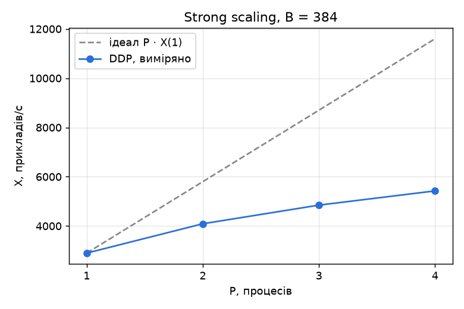
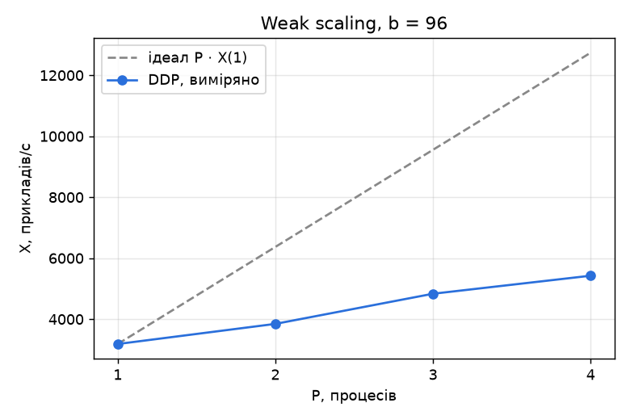
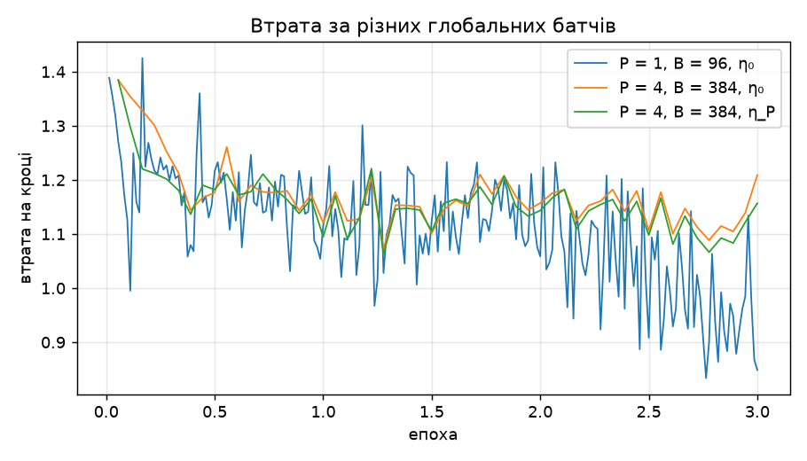

# Звіт. Лабораторна робота 6: розподілене навчання нейромережі за даними на CPU (варіант 12)

Варіант 12: датасет **Д6** (OCTMNIST, оптична когерентна томографія сітківки, K = 4, C = 1), ширина мережі **Ш1**
(16 / 32 / 128), **P_max = 4**, **B = 384**, **K_c = 10**, **s_f = 25**. Навчальна частина — перші N = 7000 прикладів
train, тестова — усе розбиття test. SGD з моментом 0,9, η₀ = 0,02, n_ep = 3, `torch.manual_seed(0)` до створення моделі.

Умови вимірювань: той самий ноутбук, що й у лабораторних 2-5 (Windows 11, Intel Core i5-10300H, 4 фізичні ядра / 8 логічних),
Python 3.14.5, PyTorch 2.14.1, бекенд gloo. На час замірів кластер k3d `lab3` був зупинений, контейнерів docker не було.
n_th = ⌊C_phys / P_max⌋ = ⌊4 / 4⌋ = 1 для всіх прогонів, включно з одним процесом.

Методика вимірів швидкості за умовою: 10 кроків прогріву, 50 вимірюваних, t_step — медіана часу 50 кроків процесу 0,
X = 50 · B / t. Час кроку вимірюється від `zero_grad` до кінця `opt.step()`, t — від початку 11-го до кінця 60-го кроку.
Кожну конфігурацію я виміряла 3 рази окремими запусками, повтори йшли по черзі (усі конфігурації, далі наступний повтор).
У таблицях узято медіанний прогін: той, у якого X медіанне, і t_step з нього ж. Усі X наведено під таблицею 3.

Сирі результати: `results/lab6/*.json`, журнал: `results/lab6/log_run.txt`, автоматичний підсумок:
`results/lab6/summary_lab6.md` (`python scripts/analyze_lab6.py`), графіки: `results/lab6/figs/`. Порядок команд: `README_LAB6.md`.
Повний прогін зайняв 17,3 хв, 47 запусків, усі з кодом 0.

## 1. Стенд і навчання в одному процесі (крок 1)

`ddp/common.py` містить код з умови (`load_split`, `Net`, `n_params_formula`) і завантажує `data/octmnist.npz` з Zenodo, якщо
файла немає. `ddp/train.py` — один скрипт для всіх режимів: `--sync none` навчає в одному процесі без `torch.distributed`.
Порядок прикладів у ньому задає той самий `DistributedSampler(num_replicas=1, rank=0, seed=0)`, тож один процес з батчем B
бачить ті самі глобальні батчі, що й P процесів (перевірено нижче за втратою).

Таблиця 1. Стенд

| Процесор | Фізичних ядер C_phys | Логічних ядер | Памʼять, ГБ | ОС | Python | PyTorch | n_th |
|---|---|---|---|---|---|---|---|
| Intel Core i5-10300H @ 2,50 GHz | 4 | 8 | 7,8 | Windows 11 (10.0.26300) | 3.14.5 | 2.14.1 | 1 |

| Датасет | K | C | c1 / c2 / h | n_params | M, МіБ | N | B | P_max |
|---|---|---|---|---|---|---|---|---|
| Д6, OCTMNIST | 4 | 1 | 16 / 32 / 128 | 206 148 | 0,786 | 7000 | 384 | 4 |

n_params, порахований PyTorch, збігся з формулою (206 148), M = 4 · 206 148 = 824 592 байт.

## 2. Ручна синхронізація і DDP (крок 2)

**Ручна синхронізація** (`--sync manual`): після `init_process_group("gloo")` ваги процесу 0 розсилаються `dist.broadcast`,
після `loss.backward()` для кожного з 8 тензорів параметрів викликається `all_reduce(SUM)` і ділення на P. t_sync — час від
першого виклику all-reduce до повернення з останнього, медіана за 50 кроків.

**Еквівалентність** (`--task equiv`): перші 384 приклади навчальної частини; процес r бере приклади r, r + 4, …, рахує
градієнт і синхронізує його вручну. Процес 0 додатково рахує g на всіх 384 прикладах на окремій копії моделі з тими самими
вагами. Далі 50 кроків навчання з ручною синхронізацією, кожен процес рахує суму всіх ваг у float64, суми збираються `all_gather`.

**DDP** (`--sync ddp`): `DistributedDataParallel(model)` з типовим `bucket_cap_mb`. t_step,ns — окремий прогін, у якому
forward і backward виконано в `with model.no_sync():`.

Таблиця 2. Синхронізація градієнтів

| Режим | t_step, мс | Час обміну на крок, мс | Частка кроку в обміні | X, прикл./с |
|---|---|---|---|---|
| 1 процес, батч B | 129,03 | 0 | 0 | 2 908 |
| 4 процеси, ручна синхронізація | 81,39 | 15,61 (t_sync) | 0,192 | 4 487 |
| 4 процеси, DDP | 68,98 | 5,13 (t_comm,exp) | 0,074 | 5 425 |
| 4 процеси, DDP, no_sync | 63,85 | 0 | 0 | 5 810 |

| max abs(g − ḡ) / max abs(g) | Різниця сум ваг між процесами після 50 кроків | ACC, 1 процес | ACC, DDP на P_max | AUC, 1 процес | AUC, DDP на P_max |
|---|---|---|---|---|---|
| 1,03·10⁻⁵ | 0 | 0,2500 | 0,2500 | 0,6090 | 0,6090 |

Відношення за тензорами:

| тензор | форма | max abs(g) | max abs(g − ḡ) | відношення |
|---|---|---|---|---|
| features.0.weight | 16×1×3×3 | 9,08·10⁻³ | 9,36·10⁻⁸ | 1,03·10⁻⁵ |
| features.0.bias | 16 | 9,74·10⁻³ | 5,68·10⁻⁸ | 5,83·10⁻⁶ |
| features.3.weight | 32×16×3×3 | 4,31·10⁻² | 9,31·10⁻⁸ | 2,16·10⁻⁶ |
| features.3.bias | 32 | 4,27·10⁻² | 7,64·10⁻⁸ | 1,79·10⁻⁶ |
| head.1.weight | 128×1568 | 2,84·10⁻² | 1,12·10⁻⁸ | 3,93·10⁻⁷ |
| head.1.bias | 128 | 5,17·10⁻² | 3,73·10⁻⁹ | 7,21·10⁻⁸ |
| head.3.weight | 4×128 | 7,00·10⁻² | 7,45·10⁻⁹ | 1,06·10⁻⁷ |
| head.3.bias | 4 | 2,22·10⁻¹ | 1,49·10⁻⁸ | 6,72·10⁻⁸ |

Що я отримала:

- ḡ збігається з g до 1,03·10⁻⁵ від max abs(g), тобто в межах похибки float32; найбільше відношення в першої згортки.
- Після 50 кроків суми ваг усіх чотирьох процесів однакові до останнього знака (20,578633100934), різниця 0: ваги між
  процесами не розходяться, хоча вони не пересилаються.
- Втрата на кожному з 54 кроків у DDP на 4 процесах відрізняється від втрати одного процесу з батчем 384 щонайбільше на
  7,15·10⁻⁷, ACC і AUC після 3 епох однакові.
- DDP з типовим кошиком на цій моделі має **один кошик 824 592 байт = M** (з логів DDP після першого кроку): уся модель
  менша за 1 МіБ, тому all-reduce починається лише після кінця backward і з обчисленням не перекривається. Тим не менш,
  виміряний обмін DDP (5,13 мс) утричі менший, ніж 8 окремих all-reduce ручної синхронізації (15,61 мс), і DDP швидший
  на 15 % за X.
- Ручна синхронізація в трьох повторах: t_step 76,63 / 81,63 / 81,39 мс, t_sync 18,63 / 16,31 / 15,61 мс.
- ACC = 0,2500 = 1 / K для обох режимів, тобто за 54 кроки з η₀ = 0,02 мережа практично не навчилась відрізняти класи
  за argmax, хоча AUC = 0,609 > 0,5. Детальніше про якість — у розділі 4.

## 3. Strong scaling (крок 3)

DDP, B = 384, b = 384 / P, прогін з P = 1 теж через torchrun з DDP.

Таблиця 3. Strong scaling, B = 384

| P | b | t_step, мс | t_step,ns, мс | X, прикл./с | S | E | e | c |
|---|---|---|---|---|---|---|---|---|
| 1 | 384 | 128,58 | 130,99 | 2 900 | 1,00 | 1,000 | − | −0,019 |
| 2 | 192 | 86,96 | 83,06 | 4 091 | 1,41 | 0,705 | 0,418 | 0,045 |
| 3 | 128 | 76,73 | 67,21 | 4 847 | 1,67 | 0,557 | 0,397 | 0,124 |
| 4 | 96 | 68,98 | 63,85 | 5 425 | 1,87 | 0,468 | 0,379 | 0,074 |

X усіх повторів: P = 1: 3 110, 2 900, 2 881; P = 2: 4 279, 4 091, 3 887; P = 3: 5 051, 4 847, 4 710; P = 4: 5 836, 5 270, 5 425.

- На 4 процесах прискорення 1,87 замість 4, ефективність 0,47.
- Частка обміну c не більша за 0,12, тобто обмін забирає мало. Для P = 1 c = −0,019: обміну там немає, і різниця
  t_step та t_step,ns — це розкид між окремими прогонами (між повторами X різниться до 10 %).
- Метрика Карпа-Флатта e ≈ 0,38–0,42 і з P не зростає, тобто нерозпаралелена частина не визначається обміном.
- Основна причина — обчислення одного процесу сповільнюються, коли поруч працюють інші. Це видно з таблиць 3 і 4 за того
  самого b = 96: один процес робить крок за 29,34 мс (таблиця 4, P = 1), а кожен з 4 процесів без обміну (no_sync) —
  за 63,85 мс, у 2,2 раза довше. Обмін додає до цього лише 5 мс. 4 процеси займають усі 4 фізичні ядра ноутбука, і вони
  ділять спільний кеш L3, памʼять і частоту процесора.

## 4. Weak scaling і правило масштабування η (крок 4)

DDP, b = 96, B_P = 96 · P.

Таблиця 4. Weak scaling, b = 96

| P | B_P | t_step, мс | X, прикл./с | S_w | E_w |
|---|---|---|---|---|---|
| 1 | 96 | 29,34 | 3 185 | 1,00 | 1,000 |
| 2 | 192 | 46,69 | 3 845 | 1,21 | 0,604 |
| 3 | 288 | 57,00 | 4 833 | 1,52 | 0,506 |
| 4 | 384 | 68,98 | 5 425 | 1,70 | 0,426 |

Рядок P = 4 узято з таблиці 3.

За незмінної роботи на процес t_step зростає з 29 до 69 мс, тож E_w спадає до 0,43; причина та сама, що й у strong scaling.

Таблиця 5. Якість за різних глобальних батчів (n_ep = 3)

| Режим | B_P | η | Кроків оптимізатора за n_ep епох | ACC | AUC | Найбільша втрата за останню епоху |
|---|---|---|---|---|---|---|
| P = 1 | 96 | 0,02 | 216 | 0,3610 | 0,7079 | 1,2325 |
| P = 4, з кроку 2 | 384 | 0,02 | 54 | 0,2500 | 0,6090 | 1,2091 |
| P = 4 | 384 | 0,08 (η_P = η₀ · 384 / 96) | 54 | 0,3370 | 0,6641 | 1,1825 |

- З батчем 384 за 3 епохи виконується в 4 рази менше кроків (54 проти 216), і з тим самим η₀ мережа навчилась найгірше:
  ACC 0,250, AUC 0,609.
- Лінійне правило (η = 0,08) повернуло більшу частину якості: ACC 0,337 і AUC 0,664 проти 0,361 і 0,708 з одним процесом
  і b = 96.
- Розходження навчання з η = 0,08 без розігріву не було: втрата перших 10 кроків 1,385, 1,298, 1,220, 1,212, 1,202,
  1,181, 1,137, 1,190, 1,182, 1,211, тобто після 7-го кроку вона коливається, але не зростає.
- Для всіх трьох режимів 3 епохи по 7000 прикладів замало: найбільша втрата останньої епохи ≈ 1,2 (для 4 класів
  втрата випадкового вгадування ln 4 ≈ 1,386).

## 5. Контрольні точки і відмова процесу (крок 5)

`ddp/train.py --ckpt-every 10 --fail-step 25 --workdir …`: кожні 10 кроків процес 0 зберігає модель, оптимізатор,
епоху, номер батча в епосі і крок у `ckpt.tmp` і перейменовує в `ckpt.pt` (`os.replace`), далі `dist.barrier()`.
Процес з rank 3 на початку кроку 25 створює `failed.marker` (з моментом t_f) і завершується `os._exit(1)`. Під час старту
кожен процес читає `ckpt.pt`, якщо він є, відновлює модель і оптимізатор, викликає `sampler.set_epoch(epoch)` і пропускає
`step_in_epoch` батчів. Процес 0 записує моменти подій у `events.jsonl` і втрату кожного кроку в `losses.jsonl`.
Запуск: `torchrun --nnodes=1 --nproc_per_node=4 --max-restarts=1 --rdzv-backend=static --master-addr=127.0.0.1
--master-port=29500 --node-rank=0`.

Таблиця 6. Відмова і відновлення

| K_c | s_f | Крок останньої контрольної точки | Кроків виконано повторно | t_lost, с |
|---|---|---|---|---|
| 10 | 25 | 20 | 4 | 11,34 |

| Крок | 23 | 24 | 25 | 26 | 27 | ACC після n_ep епох |
|---|---|---|---|---|---|---|
| Втрата, прогін з відмовою | 1,072351 | 1,153549 | 1,152742 | 1,150328 | 1,101682 | 0,2500 |
| Втрата, прогін без відмови | 1,072351 | 1,153549 | 1,152742 | 1,150328 | 1,101682 | 0,2500 |

- Кроки 21–24 виконано двічі, повтор дав ту саму втрату біт у біт.
- t_lost = (t_f − t_c) + t_r = 0,32 + 11,02 = 11,34 с. Сама втрачена робота (4 кроки) — лише 0,32 с, решта — перезапуск:
  1,00 с від відмови до старту процесів нової спроби, 5,05 с імпорт PyTorch і створення групи, 4,08 с завантаження даних,
  моделі й контрольної точки, 0,89 с перший крок після відновлення. Тобто на цій моделі t_lost визначається часом
  перезапуску (≈ 160 кроків навчання), а не інтервалом K_c.
- Втрата з відмовою збігається з втратою без відмови біт у біт на кроках 1–29, а з кроку 30 відрізняється щонайбільше на
  2,17·10⁻⁷ відносно; ACC однакова. Щоб перевірити, чи це через DDP, я повторила ту саму відмову з ручною синхронізацією
  і порівняла з її прогоном без відмови: там втрата всіх 54 кроків збігається біт у біт. Отже, ця різниця виникає лише з DDP;
  точну причину всередині DDP я не встановлювала.

## 6. Що довелося виправити, щоб запуск працював

- **Перезапуск зі статичною адресою зависав.** Під час перевірки стенду на Linux (PyTorch 2.15) після відмови нова спроба
  висіла в `init_process_group`: агент torchrun зі `--rdzv-backend=static` використовує те саме сховище TCPStore, у якому
  лишились ключі gloo першої спроби. У `init_group()` (`ddp/train.py`) я відокремила ключі кожної спроби префіксом
  `attempt_<TORCHELASTIC_RESTART_COUNT>` (`dist.PrefixStore`), після цього перезапуск проходить.
- **torchrun на Windows не стартував:** `use_libuv was requested but PyTorch was built without libuv support`. У PyTorch 2.14
  TCPStore вмикає libuv за замовчуванням і не читає `USE_LIBUV=0`. `ddp/torchrun_win.py` запускає torchrun, підмінивши
  TCPStore на варіант з `use_libuv` зі змінної `USE_LIBUV`; те саме додано в `init_group()`.
- **На Windows після відмови не було перезапуску:** агент зупиняє решту воркерів через `CTRL_C_EVENT`, воркери, що чекають
  у gloo all-reduce, його не обробляють, а сигнал отримує вся консоль, зокрема сам агент і `run_lab6.py`.
  `ddp/torchrun_win.py` замінює сигнал зупинки на SIGTERM (на Windows це TerminateProcess), а `run_lab6.py` запускає
  кожен прогін у власній прихованій консолі (`CREATE_NO_WINDOW`).
- У теці OneDrive видалення теки результатів давало `Access is denied`, тому `run_lab6.py` очищує її вміст, а не видаляє теку.

## Висновки

1. Паралельний крок з усередненням градієнтів дає той самий градієнт, що й один процес на всьому батчі (різниця до
   1,03·10⁻⁵ від max abs(g)), ваги процесів після 50 кроків однакові, втрата DDP на 4 процесах збігається з одним процесом
   до 7·10⁻⁷.
2. На моделі Ш1 (M = 0,79 МіБ) DDP має один кошик, тому обмін не перекривається з backward, але все одно займає лише
   5 мс з 69 (c = 0,074), утричі менше за 8 окремих all-reduce ручної синхронізації.
3. Масштабування на ноутбуці обмежує не обмін, а сповільнення обчислень, коли 4 процеси одночасно працюють на 4 ядрах:
   strong S(4) = 1,87, E = 0,47, weak E_w(4) = 0,43, e ≈ 0,4 і з P не зростає.
4. Більший глобальний батч за ту саму кількість епох дає в P разів менше кроків і гіршу якість (ACC 0,250 проти 0,361);
   лінійне правило η_P = 0,08 повертає більшу частину (ACC 0,337) і без розігріву не розходиться.
5. Відновлення з контрольної точки повторює рівно 4 кроки і відтворює ту саму втрату; t_lost = 11,3 с майже повністю
   складається з перезапуску процесів.
