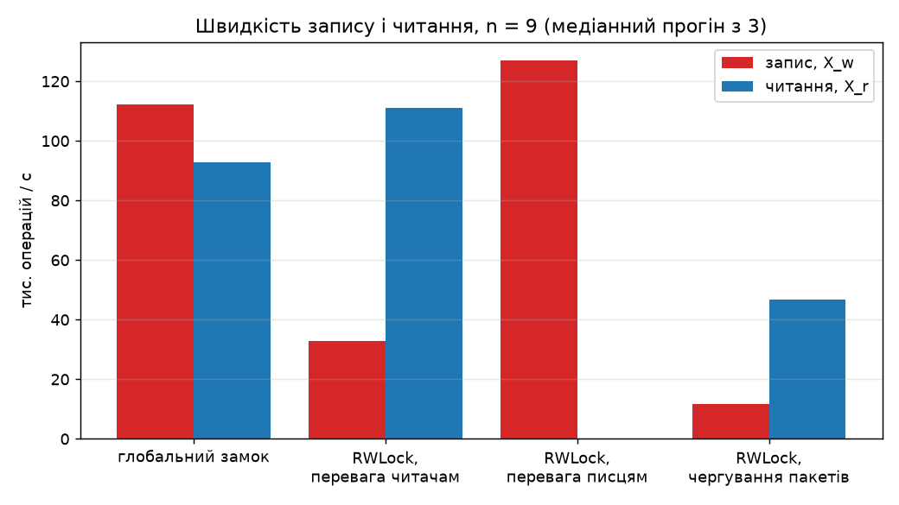
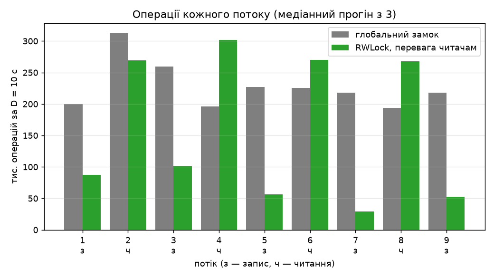
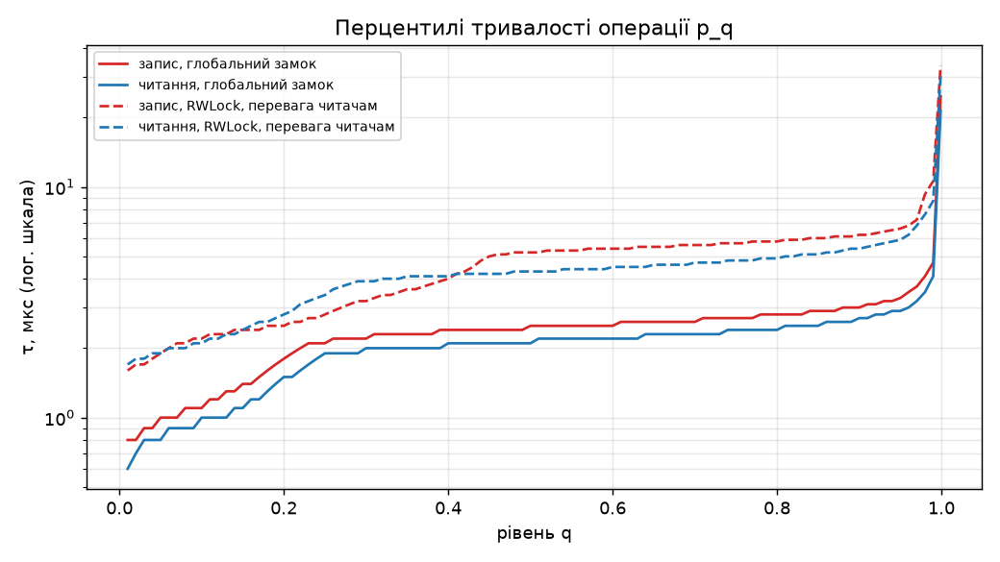

# Підсумок лабораторної 5 (варіант 12): С2, хеш-таблиця кешу за record_id

Ключі 0..9999, перед прогоном заповнено 5000; n = 9; D = 10 с, прогрів 1 с; повторів: 3. У таблицях 2-4, 6, 7 — медіанний прогін (той, у якого X медіанне; номер у таблиці «Окремі прогони»), X_1 і t_cs — медіана трьох вимірів.
Python 3.14.5 (CPython), GIL: увімкнено, sys.getswitchinterval() = 5 мс; Windows-11-10.0.26300-SP0; логічних ядер: 8.

## Таблиця 1. Стенд

| n | n_w | n_r | Мова і версія | Логічних ядер | X_1, оп/с | Інваріанти після прогонів кроків 2 і 3 |
|---|---|---|---|---|---|---|
| 9 | 5 | 4 | Python 3.14.5 | 8 | 821 191 (глобальний замок), 443 082 (RWLock) | виконано в 12 з 12 прогонів |

Перевірка інваріантів у кожному прогоні:

| спосіб | прогін | структура (вузли = size, кошики, повтори ключів) | значень у таблиці, яких ніхто не записував | get повернув значення іншого ключа | перевірено значень get / з них не записаних | size() / різних записаних ключів | ok |
|---|---|---|---|---|---|---|---|
| глобальний замок | 1 | ok | 0 | 0 | 17557 / 0 | 10000 / 10000 | так |
| глобальний замок | 2 | ok | 0 | 0 | 20654 / 0 | 10000 / 10000 | так |
| глобальний замок | 3 | ok | 0 | 0 | 16636 / 0 | 10000 / 10000 | так |
| RWLock, перевага читачам | 1 | ok | 0 | 0 | 24251 / 0 | 10000 / 10000 | так |
| RWLock, перевага читачам | 2 | ok | 0 | 0 | 20627 / 0 | 10000 / 10000 | так |
| RWLock, перевага читачам | 3 | ok | 0 | 0 | 20421 / 0 | 10000 / 10000 | так |
| RWLock, перевага писцям | 1 | ok | 0 | 0 | 311 / 0 | 10000 / 10000 | так |
| RWLock, перевага писцям | 2 | ok | 0 | 0 | 322 / 0 | 10000 / 10000 | так |
| RWLock, перевага писцям | 3 | ok | 0 | 0 | 0 / 0 | 10000 / 10000 | так |
| RWLock, чергування пакетів | 1 | ok | 0 | 0 | 8191 / 0 | 10000 / 10000 | так |
| RWLock, чергування пакетів | 2 | ok | 0 | 0 | 7814 / 0 | 10000 / 10000 | так |
| RWLock, чергування пакетів | 3 | ok | 0 | 0 | 8077 / 0 | 10000 / 10000 | так |

Лише читання (потоків читання: 4, глобальний замок, 10 с): 3 119 178 операцій get, порівняно 5004 полів таблиці і вузлів до і після, збіглися: так; неправильних значень: 0.
Лише читання (потоків читання: 4, RWLock, перевага читачам, 10 с): 2 140 286 операцій get, порівняно 5004 полів таблиці і вузлів до і після, збіглися: так; неправильних значень: 0.

## Таблиця 2. Глобальний замок

| Роль | Операцій за D | X, оп/с | p50, мкс | p99, мкс | Найбільший t_wait, мс | w | cv | t_cs, мкс |
|---|---|---|---|---|---|---|---|---|
| Запис | 1 123 140 | 112 314 | 2,50 | 4,70 | 385,5 | 0,593 | 0,087 | 0,809 |
| Читання | 929 023 | 92 902 | 2,10 | 4,10 | 396,5 | 0,600 | 0,208 | 0,576 |
| Разом | 2 052 163 | 205 216 | 2,30 | 4,50 | 396,5 | 0,596 | 0,156 | 0,705 (t̄_cs) |

t̄_cs = (5·0,809 + 4·0,576) / 9 = 0,705 мкс; межа 1 / t̄_cs = 1 418 482 оп/с. Накладні двох викликів perf_counter_ns підряд: 0,100 мкс (входять у t_cs).

## Таблиця 3. RWLock (RWLock, перевага читачам)

| Роль | Операцій за D | X, оп/с | p50, мкс | p99, мкс | Найбільший t_wait, мс | w | cv |
|---|---|---|---|---|---|---|---|
| Запис | 326 977 | 32 698 | 5,20 | 10,60 | 2 558,6 | 0,934 | 0,395 |
| Читання | 1 109 335 | 110 934 | 4,30 | 8,70 | 451,3 | 0,414 | 0,051 |
| Разом | 1 436 312 | 143 631 | 4,30 | 9,30 | 2 558,6 | 0,703 | 0,673 |

## Таблиця 4. Операції потоків за D секунд

| Потік | Роль | Глобальний замок | RWLock (перевага читачам) |
|---|---|---|---|
| 1 | запис | 199 972 | 87 298 |
| 2 | читання | 312 958 | 269 453 |
| 3 | запис | 259 682 | 101 331 |
| 4 | читання | 196 261 | 301 852 |
| 5 | запис | 227 199 | 56 387 |
| 6 | читання | 225 855 | 270 282 |
| 7 | запис | 218 330 | 29 038 |
| 8 | читання | 193 949 | 267 748 |
| 9 | запис | 217 957 | 52 923 |

## Таблиця 5. Метрики прискорення

| Метрика | Формула | Значення |
|---|---|---|
| S(n), глобальний замок | X(G) / X_1 = 205 216 / 821 191 | 0,250 |
| E(n), глобальний замок | S(n) / n | 0,028 |
| S(n), RWLock | X(RW) / X_1 = 143 631 / 443 082 | 0,324 |
| E(n), RWLock | S(n) / n | 0,036 |
| S_w | X_w(RW) / X_w(G) | 0,291 |
| S_r | X_r(RW) / X_r(G) | 1,194 |
| S_Σ | X(RW) / X(G) | 0,700 |
| ρ, завантаженість глобального замка | X(G) · t̄_cs = 205 216 · 0,705 мкс | 0,145 |

X(G) = 205 216 оп/с — це 14,5 % межі 1 / t̄_cs = 1 418 482 оп/с.

## Таблиця 6. Порівняння доступу до даних

| Показник | Глобальний замок: запис | Глобальний замок: читання | RWLock: запис | RWLock: читання | RW / G: запис | RW / G: читання |
|---|---|---|---|---|---|---|
| X, оп/с | 112 314 | 92 902 | 32 698 | 110 934 | 0,29 | 1,19 |
| x, на один потік ролі, оп/с | 22 463 | 23 226 | 6 540 | 27 733 | 0,29 | 1,19 |
| p50, мкс | 2,50 | 2,10 | 5,20 | 4,30 | 2,08 | 2,05 |
| p99, мкс | 4,70 | 4,10 | 10,60 | 8,70 | 2,26 | 2,12 |
| h = p99 / p50 | 1,88 | 1,95 | 2,04 | 2,02 | 1,08 | 1,04 |
| Найбільший t_wait, мс | 385,5 | 396,5 | 2 558,6 | 451,3 | 6,64 | 1,14 |
| w | 0,593 | 0,600 | 0,934 | 0,414 | 1,57 | 0,69 |
| cv | 0,087 | 0,208 | 0,395 | 0,051 | 4,51 | 0,25 |
| φ, частка ролі в усіх операціях | 0,547 | 0,453 | 0,228 | 0,772 | 0,42 | 1,71 |

## Таблиця 7. Політики RWLock (додатково)

| Спосіб | X_w, оп/с | X_r, оп/с | X, оп/с | S_w | S_r | S_Σ | найбільший t_wait запису, мс | найбільший t_wait читання, мс | cv запису | cv читання | найменше операцій одного потоку |
|---|---|---|---|---|---|---|---|---|---|---|---|
| глобальний замок | 112 314 | 92 902 | 205 216 | 1,000 | 1,000 | 1,000 | 385,5 | 396,5 | 0,087 | 0,208 | 193 949 |
| RWLock, перевага читачам | 32 698 | 110 934 | 143 631 | 0,291 | 1,194 | 0,700 | 2 558,6 | 451,3 | 0,395 | 0,051 | 29 038 |
| RWLock, перевага писцям | 126 876 | 0 | 126 876 | 1,130 | 0,000 | 0,618 | 837,2 | 10 000,0 | 0,259 | — | 0 |
| RWLock, чергування пакетів | 11 716 | 46 862 | 58 578 | 0,104 | 0,504 | 0,285 | 8,9 | 10,0 | 0,009 | 0,014 | 23 189 |

## Окремі прогони

| спосіб | прогін | початок | X_w | X_r | X | найбільший t_wait запису, мс |
|---|---|---|---|---|---|---|
| глобальний замок | 1 | 2026-11-25 18:58:35 | 106 424 | 97 778 | 204 202 | 327,7 |
| глобальний замок | 2 | 2026-11-25 18:59:23 | 130 926 | 112 572 | 243 498 | 329,0 |
| глобальний замок | 3 (медіанний) | 2026-11-25 19:00:12 | 112 314 | 92 902 | 205 216 | 385,5 |
| RWLock, перевага читачам | 1 | 2026-11-25 18:58:47 | 36 060 | 128 715 | 164 775 | 3 395,8 |
| RWLock, перевага читачам | 2 | 2026-11-25 18:59:36 | 19 488 | 120 285 | 139 773 | 4 545,4 |
| RWLock, перевага читачам | 3 (медіанний) | 2026-11-25 19:00:24 | 32 698 | 110 934 | 143 631 | 2 558,6 |
| RWLock, перевага писцям | 1 | 2026-11-25 18:59:00 | 124 891 | 1 641 | 126 532 | 468,5 |
| RWLock, перевага писцям | 2 | 2026-11-25 18:59:48 | 152 844 | 1 415 | 154 258 | 795,9 |
| RWLock, перевага писцям | 3 (медіанний) | 2026-11-25 19:00:37 | 126 876 | 0 | 126 876 | 837,2 |
| RWLock, чергування пакетів | 1 | 2026-11-25 18:59:12 | 11 992 | 47 969 | 59 962 | 13,5 |
| RWLock, чергування пакетів | 2 | 2026-11-25 19:00:00 | 11 680 | 46 721 | 58 401 | 12,8 |
| RWLock, чергування пакетів | 3 (медіанний) | 2026-11-25 19:00:49 | 11 716 | 46 862 | 58 578 | 8,9 |
| X_1, глобальний замок | 816 744, 821 191, 827 133 | | | | | |
| X_1, RWLock | 443 082, 401 478, 460 554 | | | | | |
| t_cs,w / t_cs,r, мкс | 0,941 / 0,633, 0,715 / 0,555, 0,809 / 0,576 | | | | | |

